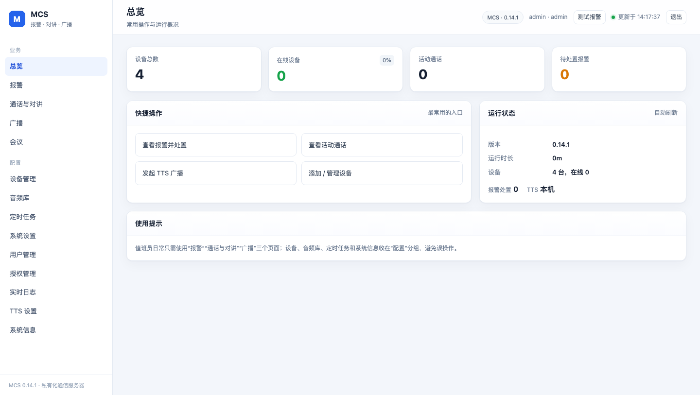
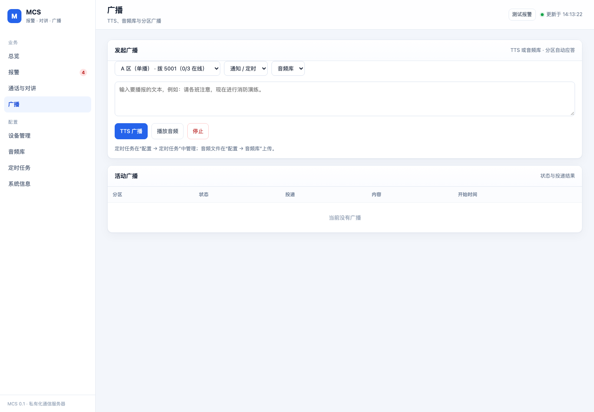

# MCS · 报警 / 对讲 / 广播融合通信服务器

> 产品代号 **MCS**（暂定）。面向报警运营、园区、校园、医院、工地等场景的私有化通信服务器。
> 当前：**注册/呼叫/录音/报警升级/广播/对讲视频·开锁·抓拍·WebRTC 双向音频+视频窗已打通**。

## 文档

| 文档 | 内容 |
| --- | --- |
| [架构说明](docs/MCS-架构说明.md) | 当前代码的部署形态、模块划分、呼叫/媒体/广播/报警内部机制与边界 |
| [使用手册](docs/MCS-使用手册.md) | 安装、登录、设备、报警、广播、寻呼、对讲、TLS/SRTP、故障排查 |
| [API 参考](docs/MCS-API参考.md) | 当前已实现的 REST / WebSocket 接口 |
| [OpenAPI](docs/openapi.yaml) | 机器可读的 OpenAPI 3 规范（26 个路径） |
| [测试与兼容性](docs/MCS-测试与兼容性.md) | 自动化覆盖、已验证环境、终端兼容边界 |
| [真机测试指南](docs/MCS-真机测试指南.md) | LAN 拓扑、终端配置、测试用例、抓包排查 |
| [广播终端接入](docs/MCS-广播终端接入.md) | 广播协议、Alert-Info、SDP、单播/组播终端要求 |
| [实时日志](docs/MCS-实时日志.md) | WebSocket 实时日志、486 排查、下载/过滤 |
| [系统设置](docs/MCS-系统设置与重启.md) | 网页修改网络/监听/业务参数、重启、回滚 |
| [用户与权限](docs/MCS-用户与权限.md) | admin/operator/viewer、首次管理员、用户管理 |
| [电话会议](docs/MCS-会议.md) | 会议室配置、混音、静音/踢出、录音、API |
| [TTS 服务配置](docs/MCS-TTS服务配置.md) | 本地/OpenAI/千问/MiniMax，控制台配置与 API |
| [配置参考](docs/MCS-配置参考.md) | `config.yaml` 全字段与默认值 |
| [部署手册](deploy/README.md) | systemd / Windows 服务 / Inno Setup 安装包 / HTTPS / TLS / SRTP |
| [技术方案](docs/MCS-技术方案.md) | 早期设计与规划（含未实现内容；实际架构以架构说明为准） |
| [产品方案](docs/MCS-产品方案.md) | 产品范围与路线图（规划） |
| [接口规划稿](docs/MCS-接口与数据模型.md) | 远期接口/数据模型，未实现部分不要直接对接 |

## 现在能跑什么

| 能力 | 状态 |
| --- | --- |
| SIP 注册（UDP） | ✅ Digest 鉴权、源地址记录、过期、注销、OPTIONS 保活响应 |
| 呼叫（B2BUA） | ✅ INVITE/180/200/ACK/BYE/CANCEL，8xxx 报警短号路由 |
| RTP 中继 | ✅ 双向中继、SDP 改写、首包锁存（NAT 基础） |
| G.711 转码 | ⚙️ 可选兼容层，默认关闭；`media.transcode: true` 才启用 |
| 录音 / 话单 | ✅ 双向 G.711 → 立体声 WAV；CDR 含结果/时长/录音链接 |
| 报警策略 / 升级 | ✅ config.yaml 配置多级值班；超时自动取消并呼下一级 |
| 报警事件 / 处置 | ✅ SQLite 事件、列表、关闭处置、WebSocket 推送 |
| 报警弹屏 | ✅ 面板红色告警条 + 提示音；可点“测试弹屏” |
| 设备面板 | ✅ 在线状态、型号/固件、来源地址；2 秒刷新 |
| SQLite 持久化 | ✅ 设备、话单、报警事件落库 `data/mcs.db`，重启保留 |
| SIP over TLS | ✅ 可选 5061，PEM 证书，TLS 1.2+ |
| HTTPS 控制台 | ✅ 可选 8443，复用/独立 PEM 证书 |
| SRTP（SDES） | ✅ 音频/视频，AES_CM_128_HMAC_SHA1_80/32，按腿独立密钥 |
| 设备管理 | ✅ Web 控制台新增/删除设备，SQLite 持久化；config 首次导入 |
| 控制台登录 | ✅ Cookie 会话 + bcrypt，单管理员 |
| M1 安装 | ✅ Linux systemd / Windows 原生 Service / Inno Setup 安装包 |
| 广播 / TTS | ✅ 分区、优先级抢占、单播/组播、自动应答、逐终端状态；支持 PCMU/Opus |
| 电话会议 | ✅ 8 方 PCMU/PCMA 混音、网页建房/停用/删除、静音/踢出、混音录音 |
| 会议视频/WebRTC | ✅ SIP H264 当前发言人转发、网页麦克风/摄像头加入、HTTPS/本机安全上下文 |
| 实时寻呼 | ✅ 话机拨分区短号（如 5001）直接对分区讲话 |
| 视频对讲（SIP） | ✅ H.264 透传，双向视频中继 |
| 远程开锁 | ✅ 通话中向门口机发送 DTMF INFO |
| 抓拍 | ✅ 按设备配置的 HTTP 快照地址代理返回图片 |
| WebRTC 视频窗 | ✅ 浏览器接收 H.264 视频 |
| WebRTC 双向音频 | ✅ 浏览器麦克风 → 对讲门口机；门口机声音 → 浏览器 |
| 音频库 | ✅ 上传 WAV/MP3、列表、下载、删除、按库播放 |
| 定时广播 | ✅ 5 段 cron、启停、持久化、到期自动 TTS/音频 |
| TTS | ✅ 本地 Kokoro、OpenAI、千问、MiniMax；控制台可配、缓存 |
| REST / WS API | ✅ 设备、通话、话单、报警、广播、事件流 |
| 模拟注册 | ✅ `cmd/uasim` 批量注册，开发联调用 |
| WebRTC 视频回传 / TURN / 寻呼 | ⏳ 下一阶段 |

跨平台二进制已可产出（Linux x86_64/arm64、Windows amd64、macOS arm64/amd64），单文件约 18MB（含 Pion + SQLite）。

## 界面

控制台改成浅色侧边栏布局，默认只展示“总览”。左侧把界面分成两组：

- **业务**：总览、报警、通话与对讲、广播；
- **配置**：设备管理、音频库、定时任务、系统信息。

值班员日常只接触业务页面；配置页面集中管理，减少误操作。手机/窄屏会自动切换为顶部导航。





## 快速开始

```bash
make build
make run-https     # 自签证书 + HTTPS 38443，开发最快
# 打开 https://127.0.0.1:38443/  或 http://127.0.0.1:38084/
```

普通 HTTP：

```bash
cp config.example.yaml config.yaml
make build
./bin/mcs -config config.yaml
# 浏览器打开 http://127.0.0.1:8080
# 若配置了 auth.console_password，会先弹出登录框（默认用户 admin）
```

> 38443 只由 `make run-https` 或 `server.https` 配置启用；默认 HTTP 配置不会监听该端口。

真机联调（绑定 LAN IP、5060、独立 data-lan）：

```bash
make run-lan
```

> `advertise` 必须是设备能访问到的地址。本机软电话填 `127.0.0.1:5060`；局域网真机要改成服务器 LAN IP，否则会出现单通/无声音。

TTS 可以在“配置 → TTS 设置”切换本地 Kokoro、OpenAI、千问或 MiniMax，不需要改配置文件或重启。

用两台 SIP 软电话（Linphone / Zoiper）分别注册：

| 账号 | 密码 | 服务器 |
| --- | --- | --- |
| 1001 | pass-1001 | 127.0.0.1:5060（UDP） |
| 1002 | pass-1002 | 127.0.0.1:5060（UDP） |

用 **1002 拨 8000**，1001 会振铃；15 秒不接会自动取消并升级到 `1003`（在线时）。接听后双向语音。面板会显示活动通话、报警事件，挂断后出现话单和“播放”录音链接。报警事件可在“报警事件”表里点“处置”关闭。

也可以只注册、看设备面板：

```bash
make uasim
./bin/uasim -server 127.0.0.1:5060 \
  -accounts '1001:pass-1001,1002:pass-1002,1003:pass-1003'
```

点页面右上角“测试弹屏”可验证 WebSocket 告警条。

### 广播（本机 TTS）

本机 TTS 服务按 OpenAI 方式调用（默认 `http://127.0.0.1:8399`）：

```bash
curl -X POST http://127.0.0.1:8399/v1/audio/speech \
  -H 'Content-Type: application/json' \
  -d '{"input":"你好，我是本地语音服务。","voice":"zf_001","response_format":"wav"}' \
  -o hello.wav
```

MCS 的 `tts.voice_zh` / `tts.voice_en` 默认 `zf_001` / `af_heart`，按文本自动选择；合成结果缓存在 `data/audio/tts/`。页面“广播”区选分区、输入文本、点“TTS 广播”即可。

同一区域还可以上传 WAV 到音频库、选择后“播放音频”；下方“定时广播”用 5 段 cron（分 时 日 月 周）创建任务，支持启停/删除。

**实时寻呼**：用已注册的话机直接拨分区短号（`config.example.yaml` 里 `a` 区是 `5001`），MCS 接听后把话机 RTP 实时转发到该分区所有自动应答终端；挂机即停止。

> 软电话收到广播 INVITE 会振铃，需要手动接听；自研 SIP 音箱按 `Alert-Info` 自动应答。组播分区还要求终端已配置加入对应组播组。

## API

| 接口 | 说明 |
| --- | --- |
| `POST /api/v1/login` | 控制台登录（Cookie 会话） |
| `POST /api/v1/logout` | 退出登录 |
| `GET /api/v1/session` | 当前登录状态 |
| `GET /api/v1/devices` | 设备/在线状态 |
| `POST /api/v1/devices` | 新增设备 |
| `PATCH/DELETE /api/v1/devices/{ext}` | 修改 / 删除设备 |
| `GET /api/v1/calls/active` | 活动通话 |
| `GET /api/v1/cdr?limit=20` | 话单 |
| `GET /api/v1/alarms?limit=20` | 报警事件 |
| `POST /api/v1/alarms/{id}/close` | 关闭报警并填写处置结果 |
| `GET /api/v1/broadcast/zones` | 广播分区与在线数 |
| `POST /api/v1/broadcast/start` | TTS 广播（zone_id/text/priority） |
| `POST /api/v1/broadcast/stop` | 停止分区广播 |
| `GET /api/v1/broadcast/active` | 活动广播 |
| `GET/POST /api/v1/media` | 音频库列表 / 上传 WAV |
| `DELETE /api/v1/media/{id}` | 删除音频 |
| `GET /api/v1/media/{id}/download` | 下载音频 |
| `GET/POST /api/v1/broadcast/schedules` | 定时任务列表 / 新增 |
| `PATCH/DELETE /api/v1/broadcast/schedules/{id}` | 启停 / 删除 |
| `POST /api/v1/webrtc/offer` | 浏览器 WebRTC 双向音频 + 视频接收 offer/answer |
| `GET /api/v1/ws` | WebSocket 事件（call/alarm/device/broadcast） |

完整字段、状态码和 curl 示例见 [API 参考](docs/MCS-API参考.md)。
| `POST /api/v1/alarm/test` | 模拟报警弹屏 |
| `/recordings/...` | 录音 WAV 回放 |

M1 部署见 [deploy/README.md](deploy/README.md)：Linux systemd、Windows 原生 Service、SIP TLS 证书。

```bash
make package
tar xzf dist/mcs-linux-amd64.tar.gz && cd mcs
sudo ./install-linux.sh ./mcs ./config.example.yaml
```

## 已验证

- `go test ./...`：Digest RFC 2617 向量、注册/错误密码、**端到端呼叫**（INVITE 8000 → 1002 应答 → 双向 RTP → WAV → CDR → BYE）
- **报警升级**：1002 振铃不应答 → 1s 后取消 → 升级 1003 → 应答 → 报警事件 `level=1, answered_by=1003`
- **报警 API**：创建 → 列表 → 关闭处置；WebSocket `alarm.created` 事件
- **广播**：1 秒 TTS WAV → 两个自动应答终端各收到 RTP；`delivered=2`
- **广播抢占**：低优先级长广播 → 高优先级短广播抢占，低优先级状态 `preempted`
- **音频库**：上传 WAV → 列表/下载 → 按库广播到自动应答终端
- **定时任务**：cron 解析/到期推进/停用/JSON 持久化测试
- **实时寻呼**：话机拨 5001 → 两个自动应答音箱收到实时 RTP → 挂机停止
- **SQLite**：写话单/报警/设备 → 重开 DB → 数据完整恢复
- **SRTP**：SAVP + a=crypto 呼叫 → 两端 SRTP 包可解密，MCS 逐腿重加密；SRTCP RR 可转发
- **HTTPS**：8443 控制台启动，`/api/v1/session` 可访问
- **M1 安装**：`deploy/install-linux.sh` + systemd 单元；Windows 原生 Service 安装脚本
- **视频对讲**：带 H.264 的 INVITE → 双向视频 RTP 中继 → 两端都收到视频包
- **开锁**：通话中发送 `application/dtmf-relay` INFO，门口机收到 `Signal=#`
- **抓拍**：API 代理设备 HTTP 快照，返回 JPEG
- **WebRTC 双向音频**：浏览器麦帧 → MCS → 门口机收到音频；门口机音频 → 浏览器（测试双向计数均 > 0）
- **WebRTC 视频**：浏览器 offer → Pion answer（H.264）→ 观看端收到 SIP 视频 RTP
- **TTS**：Kokoro 24kHz WAV 重采样到 8kHz；中英文 voice 自动选择与缓存命中
- **真实 Kokoro 端到端**：`MCS_REAL_TTS=1` 用本机 8399 服务合成中文 → 广播到自动应答终端 → 收到 RTP
- 真实 sipgo UAC 注册 → 401 → Digest → 200 → 面板在线
- 3 台模拟设备在线；`/calls/active`、`/cdr`、`/alarm/test`、`/ws` 均实测
- `make linux` / `make windows` / `make darwin` 交叉编译；`make dist` 一次出齐
- SQLite 话单/报警/设备写库 → 重开数据库 → 数据完整恢复（`internal/store/sqlite_test.go`）
- 控制台登录：401 → 登录 Cookie → 设备 CRUD 200 → 退出后 401
- SIP TLS 监听、systemd 单元、Windows 原生 Service 脚本已提供

## 当前边界（M1 进行中）

- 注册状态在内存（重启重新注册）；设备/话单/报警已落 SQLite。`config.yaml` 只在设备表为空时首次导入，之后以 DB 为准。
- 报警策略只做了“配置化多级顺序升级”：没有排班、并行同振、可视化策略编辑和 Webhook 通知；超时/忙自动下一级，全部失败返回 480。
- 实时寻呼目前只支持 **SIP 话机**；WebRTC 麦克风寻呼、消防联动尚未实现。
- 浏览器视频只做接收；视频回传、TURN、视频录像未做。SIP 终端之间仍只做 H.264 透传。
- 抓拍依赖设备配置 `snapshot` HTTP 地址；开锁只发 DTMF INFO，HTTP 开锁/厂商私有指令未做。
- 寻呼/呼叫 INVITE 暂未做 Digest 鉴权，生产前需要补。
- 音频库接受 PCM16 WAV 或 MP3；单文件上限 20MB；MP3 解码后重采样/编码。
- 组播代码路径已实现但未在真实组播网络验证；固定 RTP 端口段未做。
- SRTP 只实现 **SDES**（`a=crypto`）音频/视频，DTLS-SRTP 仅用于 WebRTC；SRTCP 已随安全腿转发，寻呼/广播/报警组呼仍是明文 RTP。
- SDES 密钥在 SDP 里，生产应强制 SIP over TLS；否则密钥随信令明文传输。多平台安装脚本已提供，但未做签名安装包。
- 录音为 G.711 8kHz 立体声 WAV；G.722/Opus 转码未做。
- 控制台只有单管理员账号，没有 RBAC/多用户/审计登录失败；可启用内置 HTTPS，或放在反向代理后。

## 目录

```text
cmd/mcs/              服务入口
cmd/uasim/            开发用 SIP 终端模拟器（只注册）
internal/config/      YAML 配置
internal/store/       设备/注册状态 + 内存 CDR
internal/sipserver/   注册、B2BUA、RTP、录音、报警升级、广播扇出
internal/tts/         Kokoro/OpenAI 兼容 TTS 客户端
internal/api/         REST/WS API + 日志中间件
internal/webui/       go:embed 管理面板
docs/                 架构/产品/技术/接口/配置/部署文档
poc/sipgo-smoke/      sipgo 最小验证
```

## 下一阶段

1. DTLS-SRTP 终端、寻呼/广播 SRTP；多用户 RBAC、登录失败锁定；
2. 对讲：WebRTC 视频回传、TURN、视频录像；
3. 广播：WebRTC 麦克风寻呼、消防联动、节假日日历；
4. 报警排班、并行同振、Webhook/短信通知；
5. 固定 RTP 端口段 + 跨平台安装包签名。

## 方案文档

| 文档 | 内容 |
| --- | --- |
| [MCS 产品方案](docs/MCS-产品方案.md) | 定位、场景、50/100/200/500 分级、83 项功能、里程碑 |
| [MCS 技术方案](docs/MCS-技术方案.md) | 架构、SIP/媒体、报警/对讲/广播引擎、设备协议、部署、安全 |
| [MCS 接口与数据模型](docs/MCS-接口与数据模型.md) | REST/WS/Webhook/MQTT、数据库表 |
| [可行性评估](docs/可行性评估与总体方案.md) | 早期路线与预算评估（背景） |

## 约定

- 设备协议：MCS Device Profile v1（技术方案 8.7），自研设备统一注册头、自动应答、组播、开锁、快照。
- 广播：标准 SIP 自动应答 + 组播；TTS 在线；视频标准 H.264 透传。
- 平台：Linux 首发，Windows 同代码随后。
