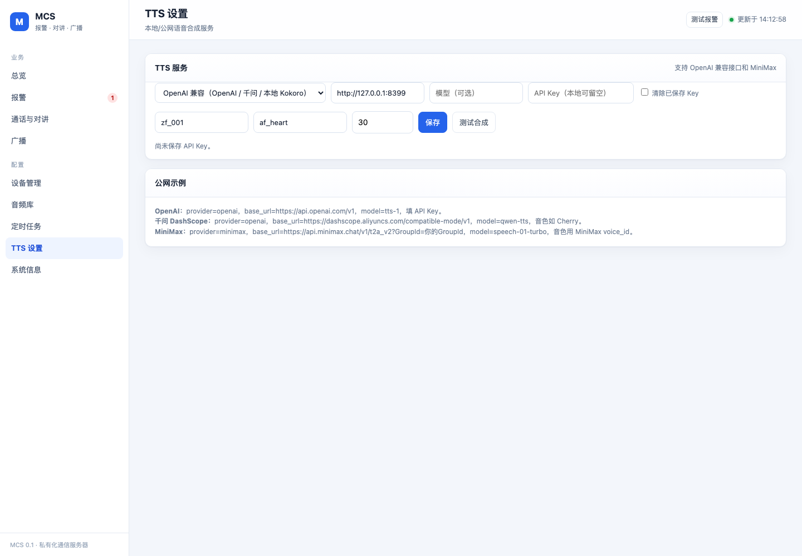

# MCS TTS 服务配置

MCS 支持两类 TTS 服务：

| provider | 适用 |
| --- | --- |
| `openai` | OpenAI 官方、千问 DashScope 兼容模式、本地 Kokoro-82M 等 OpenAI `/v1/audio/speech` 接口 |
| `minimax` | MiniMax `t2a_v2` 接口 |

配置可在两处修改：

1. `config.yaml` 的 `tts` 段（默认值）；
2. 控制台“配置 → TTS 设置”（保存到 SQLite，**优先级高于 YAML**）。

## 1. 配置页面

登录控制台 → 配置 → TTS 设置：




- 选择 provider；
- 填接口地址、模型、API Key；
- 填中文/英文音色；
- 保存；
- 点“测试合成”，成功会返回音频字节数。

API Key 不会回显；留空保存表示保留原值，勾选“清除已保存 Key”才会删除。

## 2. 本地 Kokoro

```yaml
tts:
  provider: "openai"
  base_url: "http://127.0.0.1:8399"
  api_key: ""
  model: ""
  voice_zh: "zf_001"
  voice_en: "af_heart"
  timeout_s: 30
```

请求：

```text
POST http://127.0.0.1:8399/v1/audio/speech
{"model":"","input":"你好","voice":"zf_001","response_format":"wav"}
```

## 3. OpenAI

```yaml
tts:
  provider: "openai"
  base_url: "https://api.openai.com/v1"
  api_key: "sk-..."
  model: "tts-1"
  voice_zh: "alloy"
  voice_en: "alloy"
  timeout_s: 30
```

MCS 会自动在 base_url 后拼接 `/audio/speech`。

## 4. 千问 DashScope

```yaml
tts:
  provider: "openai"
  base_url: "https://dashscope.aliyuncs.com/compatible-mode/v1"
  api_key: "sk-..."
  model: "qwen-tts"
  voice_zh: "Cherry"
  voice_en: "Cherry"
```

千问兼容模式同样走 `/audio/speech`，具体可用模型/音色以 DashScope 账号为准。

## 5. MiniMax

MiniMax 的 `GroupId` 需要放在 URL 查询参数里：

```yaml
tts:
  provider: "minimax"
  base_url: "https://api.minimax.chat/v1/t2a_v2?GroupId=你的GroupId"
  api_key: "..."
  model: "speech-01-turbo"
  voice_zh: "female-shaonv"
  voice_en: "female-shaonv"
  timeout_s: 30
```

MCS 发送：

```json
{
  "model": "speech-01-turbo",
  "text": "你好",
  "stream": false,
  "voice_setting": {"voice_id": "female-shaonv", "speed": 1, "vol": 1, "pitch": 0},
  "audio_setting": {"sample_rate": 32000, "bitrate": 128000, "format": "mp3", "channel": 1}
}
```

MiniMax 返回的 `data.audio` 支持 hex/base64，MCS 解码后按 WAV/MP3 处理。

## 6. 测试与缓存

API：

```bash
# 查看（不含密钥）
curl -b cookie http://127.0.0.1:18080/api/v1/tts/config

# 保存（api_key 留空表示不修改）
curl -b cookie -X PUT http://127.0.0.1:18080/api/v1/tts/config \
  -H 'Content-Type: application/json' \
  -d '{"provider":"openai","base_url":"https://api.openai.com/v1","model":"tts-1","voice_zh":"alloy","voice_en":"alloy","timeout_s":30,"api_key":"sk-..."}'

# 测试合成
curl -b cookie -X POST http://127.0.0.1:18080/api/v1/tts/test
```

- 配置保存后立即生效，不需要重启；
- 合成结果缓存在 `data/audio/tts/`，缓存键包含 provider/model/voice/text；
- 修改配置后旧缓存不会被重新使用（缓存键变化）。

## 7. 安全

- API Key 以明文存储在 `data/mcs.db`，请限制数据库文件权限；
- 控制台生产必须启用登录 + HTTPS；
- 公网 TTS 会产生费用，建议配置额度/超时；
- 不要把 API Key 写进公开仓库。

## 8. 常见错误

| 现象 | 原因 |
| --- | --- |
| `tts status 401` | API Key 错误/缺失 |
| `tts status 404` | base_url 路径不对（OpenAI 兼容应以 `/v1` 结尾） |
| `tts returned non-audio` | 服务返回 JSON 错误或 MIME 不对 |
| MiniMax `empty audio` | GroupId/模型/音色不对，或返回结构变化 |
| 测试成功但广播无声 | 广播终端编码/自动应答问题，不是 TTS |
