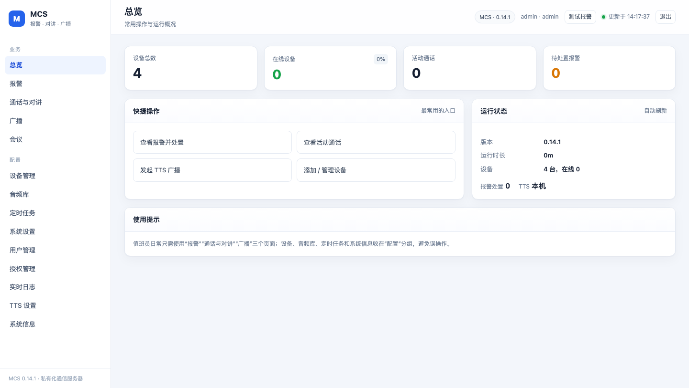
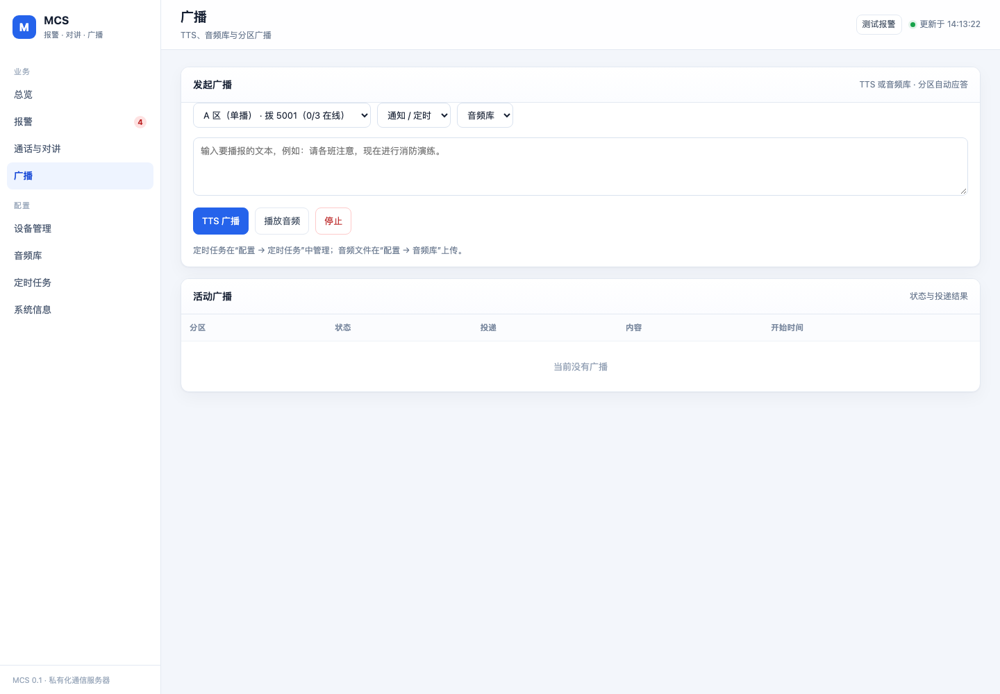

# MCS 使用手册

本手册对应当前 `0.16.3` 代码，面向部署、联调和值班人员。
规划/设计文档见 [产品方案](MCS-产品方案.md)、[技术方案](MCS-技术方案.md)；接口细节见 [API 参考](MCS-API参考.md)。

## 1. 当前能力

- SIP 注册（Digest，UDP/TLS）
- B2BUA 点对点/报警呼叫、RTP 中继、录音、话单
- 报警多级顺序升级、处置、WebSocket 弹屏
- 广播：TTS、音频库、定时任务、单播/组播、实时话机寻呼
- 对讲：H.264 视频透传、DTMF 开锁、HTTP 抓拍、WebRTC 音视频窗
- SDES-SRTP（音频/视频）、SIP TLS、HTTPS 控制台
- SQLite 设备/话单/报警持久化；单管理员登录

## 2. 快速开始

### 2.1 本机 HTTPS（推荐，一条命令）

```bash
cd minisip_server
make build
make run-https
```

脚本会：

1. 在 `data/dev-tls/` 生成自签证书（SAN: `localhost`, `127.0.0.1`）；
2. 生成 `.run/config.https.yaml`；
3. 启动：
   - 控制台：`https://127.0.0.1:38443/`
   - 会话检查：`https://127.0.0.1:38443/api/v1/session`
   - HTTP：`http://127.0.0.1:38084/`
   - SIP UDP：`127.0.0.1:15060`

浏览器会提示证书不受信任，选择“高级 → 继续访问”即可。Ctrl-C 停止。

### 2.2 普通 HTTP

```bash
cp config.example.yaml config.yaml
make build
./bin/mcs -config config.yaml
```

默认只监听 `http://127.0.0.1:8080`。如果本机 8080 已被 Docker/其他程序占用，改 `server.http` 或使用 `make run-https`。

### 2.3 登录

`config.yaml` 中：

```yaml
auth:
  console_user: "admin"
  console_password: "change-me"
```

`console_password` 非空才启用登录。浏览器会显示登录框；默认用户 `admin`。

### 2.4 界面导航

控制台是浅色侧边栏布局，默认进入“总览”。左侧导航分为：

| 分组 | 页面 | 面向 |
| --- | --- | --- |
| 业务 | 总览 | 值班员 |
| 业务 | 报警 | 值班员 |
| 业务 | 通话与对讲 | 值班员 |
| 业务 | 广播 | 值班员 |
| 配置 | 设备管理 | 管理员 |
| 配置 | 音频库 | 管理员 |
| 配置 | 定时任务 | 管理员 |
| 配置 | 系统信息 | 管理员 |

日常操作只需要“报警 / 通话与对讲 / 广播”；设备、音频、定时任务集中到配置分组。
窄屏（手机/平板）会切换为顶部的页面下拉选择，避免侧边栏占满屏幕。





## 3. 端口与目录

| 用途 | 默认 |
| --- | --- |
| SIP UDP | 5060/udp |
| SIP TCP | 5060/tcp（可选，默认关闭） |
| SIP TLS | 5061/tcp（可选） |
| 控制台 HTTP | 127.0.0.1:8080 |
| 控制台 HTTPS | 8443/tcp（可选） |
| RTP/RTCP/SRTP | 动态 UDP 端口（无固定范围） |
| WebRTC ICE | 动态 UDP；STUN/TURN 可配置 |

数据目录默认 `./data`：

```text
data/
├── mcs.db
├── recordings/
├── audio/tts/
├── audio/library/
└── broadcast/schedules.json
```

## 4. 首次联调

### 4.1 注册两台软电话

| 账号 | 密码 | 服务器 |
| --- | --- | --- |
| 1001 | pass-1001 | `<host>:5060` UDP |
| 1002 | pass-1002 | `<host>:5060` UDP |

`advertise` 必须是话机能访问到的地址。局域网真机不要保留 `127.0.0.1`，否则会出现单通/无声音。

### 4.2 报警演示

1. 1002 拨 `8000`；
2. 1001 振铃；15 秒不接，自动取消并呼叫 `1003`（在线时）；
3. 接通后双向语音；
4. 调度台报警条弹出，可点“处置”关闭；
5. 挂断后“最近通话”出现话单和录音。

### 4.3 用户与权限

首次启动会创建管理员；没有配置控制台密码时会生成 `<data_dir>/initial-admin.txt`，登录后请立即改密。

角色：

- `admin`：全部；
- `operator`：业务操作；
- `viewer`：只读。

详见 [用户与权限](MCS-用户与权限.md)。

### 4.4 系统设置

“配置 → 系统设置”可以在网页修改：

- 设备访问 IP（多网段时选择设备所在网卡）；
- SIP/HTTP/HTTPS 监听地址；
- SIP 域名、报警号码；
- Alert-Info 自动应答头；
- G.711 转码开关；
- SIP OPTIONS 心跳（默认关闭，可设置间隔/超时/失败次数）。

保存后需重启生效。重启会中断通话/广播；“恢复上次生效”可撤销未应用设置。

### 4.5 实时日志

“配置 → 实时日志”可以实时查看：

- 注册、呼叫、B 腿响应；
- `486 Busy Here`、`480 Temporarily Unavailable`；
- 广播、TTS、报警；
- HTTP API 请求（默认隐藏轮询）。

支持按级别/关键字过滤、暂停、下载。日志只保存在内存最近 1500 条。

### 4.6 广播演示

TTS 服务可在“配置 → TTS 设置”切换本地 Kokoro、OpenAI、千问或 MiniMax，详见 [TTS 服务配置](MCS-TTS服务配置.md)。

终端侧的 `Alert-Info`、SDP、PCMU 和组播要求见 [广播终端接入规范](MCS-广播终端接入.md)。

1. 页面“广播”区选择一个分区；
2. 输入文本，点“TTS 广播”；
3. 自研 SIP 音箱通过 `Alert-Info` 自动应答；普通软电话需手动接听；
4. 状态表显示投递/失败/在线终端数；
5. 音频库上传 WAV 后可点“播放音频”；
6. 定时任务按 5 段 cron（分 时 日 月 周）执行，按服务器本地时间。

### 4.4 实时寻呼

话机直接拨分区 `dial`（默认 A 区 `5001`、全区 `5002`），MCS 接听后把话机 RTP 实时转发到分区自动应答终端；挂机停止。

网页“广播”页还提供“网页实时寻呼”：

1. 选择分区；
2. 如果配置了 `paging.pin`，输入 PIN；
3. 点“开始网页寻呼”，允许麦克风；
4. 点“停止”结束。

要求：

- 网页音视频需要 HTTPS，或本机 `127.0.0.1/localhost`；
- 分区必须有在线自动应答终端；
- 普通软电话不会自动接听，需要自研 SIP 音箱/终端支持自动应答。

配置：

```yaml
paging:
  enabled: true
  pin: ""              # 网页寻呼 PIN，留空不校验
  allowed_exts: []     # 允许发起 SIP 寻呼的分机，留空不限制
```

寻呼记录：

```text
GET /api/v1/paging/events?limit=50
```

页面“寻呼记录”显示来源、分区、方式（SIP/网页）、状态和投递数。

### 4.5 对讲视频/开锁/抓拍

- 带 H.264 的门口机呼叫值班室，接听后活动通话行出现“视频”；
- 浏览器弹窗接收门口机音视频；允许麦克风后可对讲；
- “开锁”发送 DTMF INFO（默认 `#`）；
- “抓拍”打开设备 `snapshot` 配置的 HTTP 图片；
- 视频只支持浏览器接收，暂不支持浏览器视频回传。

## 5. TLS / HTTPS / SRTP

### 5.1 SIP over TLS

```yaml
server:
  sip_tls: "0.0.0.0:5061"
  tls_cert: "/etc/mcs/tls/server.crt"
  tls_key: "/etc/mcs/tls/server.key"
```

只启用 TLS 时，`advertise` 端口改成 5061。终端需信任证书或手动接受自签证书。

0.16.3 起也可以全部在网页“系统设置”中配置，不需要改配置文件。

MCS 出站 B 腿会保留终端注册时的 `transport=tls`，并支持用 `tls_ca` 信任私有 CA；内网测试可开启 `tls_insecure`。

### 5.2 HTTPS 控制台

```yaml
server:
  https: "0.0.0.0:8443"
  https_cert: "/etc/mcs/tls/console.crt"
  https_key: "/etc/mcs/tls/console.key"
```

证书为空时复用 SIP TLS 证书。HTTPS 下登录 Cookie 自动带 `Secure`。

### 5.3 SRTP

终端在 SDP 中提供：

```text
m=audio ... RTP/SAVP 0
a=crypto:1 AES_CM_128_HMAC_SHA1_80 inline:...
```

MCS 自动逐腿解密/重加密，支持 `AES_CM_128_HMAC_SHA1_80/32`、音频/视频和 SRTCP 转发。

注意：

- 只支持 **SDES-SRTP**；SIP 终端的 DTLS-SRTP 未实现。
- 网页可以设置 `srtp_mode`：`auto` / `required` / `off`。
- SDES 密钥在 SDP 中，**必须配合 SIP over TLS**，否则密钥明文传输。
- 寻呼、广播、组呼仍是明文 RTP。

### 5.4 ICE / STUN / TURN

WebRTC 默认只有 host candidate。需要跨网段/公网时，在网页“系统设置”配置：

- STUN URL；
- TURN URL；
- TURN 用户名/密码；
- WebRTC 公网 IP。

MCS 不内置 STUN/TURN 服务，使用标准 coturn 即可；MCS 作为 ICE 客户端，把配置同时下发给 Pion 和浏览器。

coturn 参考要求：

- 3478 UDP/TCP；
- TURN TLS 5349（可选）；
- 中继 UDP 端口范围；
- `external-ip=公网IP/内网IP`；
- `lt-cred-mech` 用户认证；
- 防火墙放行中继端口。

浏览器通过 ICE 配置拿到 TURN 账号；建议使用专用 TURN 账号并限制带宽。

## 6. 设备管理

- 配置里的设备只在数据库 `devices` 表为空时导入一次；
- 之后在页面“注册设备”表上方新增，或调用 `POST /api/v1/devices`；
- 删除设备会立即移出内存并删除数据库记录；
- 修改密码后，设备下次注册需使用新密码；
- 设备在线状态来自 REGISTER 的 Contact/过期时间，重启后需重新注册。

## 7. 运维

### 7.1 Linux systemd

```bash
make package
tar xzf dist/mcs-linux-amd64.tar.gz
cd mcs
sudo ./install-linux.sh ./mcs ./config.example.yaml
sudo vi /etc/mcs/config.yaml
sudo systemctl restart mcs
journalctl -u mcs -f
```

路径：`/opt/mcs/mcs`、`/etc/mcs/config.yaml`、`/var/lib/mcs/data`。

### 7.2 Windows

管理员 PowerShell：

```powershell
powershell -ExecutionPolicy Bypass -File deploy\install-windows.ps1
```

已使用原生 Windows Service（服务名 `MCS`），日志在 `C:\ProgramData\MCS\mcs.log`。

生成安装包（Windows + Inno Setup 6）：

```powershell
powershell -ExecutionPolicy Bypass -File deploy\build-windows-installer.ps1 -Version 0.1.0
# 产物：dist\MCS-Setup-0.1.0.exe
```

### 7.3 备份/恢复

```bash
sudo systemctl stop mcs
sudo tar czf mcs-backup-$(date +%F).tar.gz /etc/mcs /var/lib/mcs
sudo systemctl start mcs
```

恢复时替换目录并保持 `mcs` 用户权限。SQLite 使用 WAL，备份前最好停服。

### 7.4 升级

```bash
sudo systemctl stop mcs
sudo install -m0755 new/mcs /opt/mcs/mcs
sudo systemctl start mcs
```

数据库 schema 当前只有幂等建表；升级前先备份。

## 8. 故障排查

### 8.1 `https://127.0.0.1:38443` 打不开

按顺序检查：

1. **38443 不是默认端口**，只有 `make run-https` 或手动配置 `server.https: "127.0.0.1:38443"` 才会监听。
2. 进程是否在跑：

   ```bash
   lsof -nP -iTCP:38443 -sTCP:LISTEN
   ```

   没有输出说明没有监听。
3. 默认 `config.yaml` 里 HTTPS 是注释掉的；直接 `./bin/mcs -config config.yaml` 只开 HTTP 8080。
4. 自签证书会触发浏览器警告，不是“网页无法打开”；点“高级 → 继续访问”。
5. `/api/v1/session` 是 JSON 接口，不是 HTML 页面；看控制台请访问 `/`。

一键修复：

```bash
make run-https
# 然后打开 https://127.0.0.1:38443/
```

### 8.2 8080 被占用

```bash
lsof -nP -iTCP:8080 -sTCP:LISTEN
```

改 `server.http`，或使用 `make run-https`（38084/38443）。

### 8.3 登录 401

- 是否设置了 `auth.console_password`？
- 是否用了 HTTPS 但 Cookie 被浏览器拦截？确认地址/端口一致；
- 重启后内存会话失效，需要重新登录；
- 用 `curl -c/-b` 保存 Cookie 排查。

### 8.4 能注册但呼叫单通/无声

- `advertise` 是否是设备可达的 LAN IP/端口？
- 防火墙是否放行 SIP 与动态 RTP UDP 端口？
- 编解码是否只支持 G.711？当前只转 G.711A/U（录音）。
- 视频呼叫需要 H.264；浏览器需要 Chrome/Edge。

### 8.5 WebRTC 视频窗打不开

- 页面必须是 `localhost` 或 HTTPS（麦克风要求安全上下文）；
- 活动呼叫必须带视频（`video=true`）；
- 跨 NAT 需要配置 STUN/TURN，否则可能 ICE 失败；
- 浏览器需支持 H.264。

### 8.6 SRTP 呼叫失败

- 终端必须同时使用 `RTP/SAVP` 和 `a=crypto`；
- 只支持 `AES_CM_128_HMAC_SHA1_80/32`；
- 一端 SRTP、一端 RTP 会拒绝；
- 检查 SDP 中 MCS 返回的 `a=crypto` 和端口。

### 8.7 广播没有声音

- 终端是否在线并自动应答（`Alert-Info`）；
- 组播模式需要终端加入 `multicast` 组，当前未在真实网络验证；
- 分区成员是否正确；
- TTS 服务 `http://127.0.0.1:8399` 是否可用。

## 9. 已知限制

- 单管理员，无 RBAC/登录失败锁定/审计；
- 设备 INVITE 未做 Digest 鉴权；
- 寻呼/广播/组呼无 SRTP；
- 无 SRTCP 之外的 DTLS-SRTP SIP 终端；
- 未配置 TURN 时，跨公网 WebRTC 不稳定；
- RTP 端口动态，未做固定端口段；
- 无视频录像、ONVIF/RTSP、消防联动、短信/Webhook。
