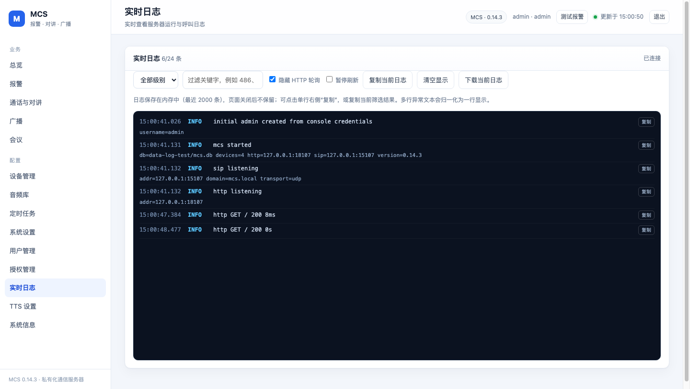

# MCS 实时日志与 486 排查

## 1. 日志控制台

控制台 → 配置 → 实时日志：



功能：

- WebSocket 实时推送；
- 级别过滤（DEBUG/INFO/WARN/ERROR）；
- 关键字过滤，例如 `486`、`1001`、`b-leg`、`call`；
- 暂停刷新、清空显示；
- 复制当前筛选日志；
- 单行右侧“复制”；
- 下载当前筛选日志；
- 多行异常文本归一化为一行显示。
- 默认隐藏 HTTP 轮询请求，避免淹没 SIP 日志；
- 内存环形缓冲最近 1500 条，重启清空。

日志文件仍在：

```text
Linux:   /var/lib/mcs/data/mcs.log（取决于启动参数）
Windows: C:\ProgramData\MCS\mcs.log
```

## 2. 486 Busy Here 怎么判断

MCS 返回 486 只有两个来源：

### 2.1 B 腿设备返回 486

日志会出现：

```text
call incoming
b-leg invite ... to=1001 uri=...
b-leg response ... code=486 reason=Busy Here
b-leg attempt failed ... result=busy
call rejected ... code=486 reason=Busy Here
```

说明 **被叫设备自己忙**，MCS 只是透传：

- 被叫正在通话；
- 被叫开启了 DND/忙线；
- 被叫拒绝第二路呼叫；
- 被叫账号被多个终端注册，INVITE 被其中一路拒绝；
- 报警转接时所有值班目标都忙。

### 2.2 寻呼分区忙

如果拨的是分区寻呼短号（如 5001/5002），日志会出现：

```text
paging rejected zone=a code=486 error=zone busy with higher priority
```

说明该分区已有更高优先级广播/寻呼，等它结束再试。

## 3. 建议抓取内容

先按 `486` 过滤，再按以下顺序看：

1. `call incoming`：主叫、被叫、targets；
2. `b-leg invite`：真正发给哪台设备的 Contact URI；
3. `b-leg response`：设备返回的状态码；
4. `call rejected`：MCS 最终返回给主叫的结果。

如果只有 `call rejected`，没有 `b-leg response`，说明 B 腿 INVITE 没收到响应，重点看目标 Contact/IP/防火墙/NAT，而不是 486 本身。

## 4. 日志 API

```text
GET /api/v1/logs?limit=200
GET /api/v1/logs/ws
```

WebSocket 需要登录 Cookie；第一条为 history，之后为实时 entry。
