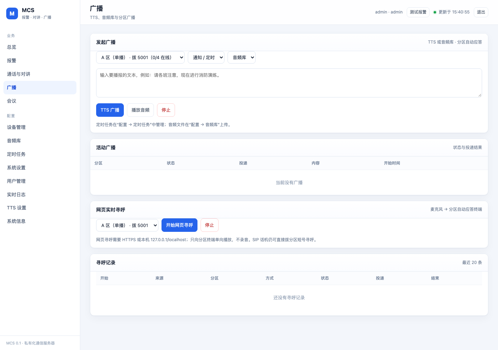

# MCS 实时寻呼功能用户手册

**适用版本：MCS 0.8.0**  
**文档版本：2026-11-23**

---

## 1. 功能简介

实时寻呼是值班人员用话筒或网页麦克风，**立即对指定分区讲话**的功能。讲话内容实时播放到该分区的自动应答终端，挂断或点“停止”后结束。

它适合：

- 临时通知；
- 现场调度；
- 找人、挪车、巡逻提醒；
- 安全提醒；
- 指挥中心对指定区域喊话。

实时寻呼是**单向讲话**：值班人员说话，终端播放；终端不向值班人员回话。

如果需要双向通话，请使用“对讲”或“电话会议”。

### 1.1 三个基本要素

| 要素 | 说明 |
| --- | --- |
| 分区 | 要讲话的区域，例如 A 区、停车场、车间 |
| 自动应答终端 | 分区内能够自动接听并播放声音的 SIP 音箱/终端 |
| 操作人员 | 使用 SIP 话机或网页麦克风发起寻呼的人 |

### 1.2 三种容易混淆的业务

| 业务 | 方向 | 内容来源 | 典型用途 |
| --- | --- | --- | --- |
| 实时寻呼 | 单向 | 操作人员现场说话 | 临时通知、现场调度 |
| TTS/音频广播 | 单向 | 文字合成或预存音频 | 日常通知、定时播报 |
| 电话会议 | 双向多方 | 多方现场说话 | 多人讨论、会商 |
| 对讲 | 双向一对一 | 双方现场说话 | 门口机与值班室通话 |

> 寻呼不是 TTS 广播，也不是定时广播。  
> 定时广播和 TTS 广播由“广播”功能完成，不需要人员一直守着话筒。

---

## 2. 使用前确认

### 2.1 终端已在线

在“设备管理”或“广播”页面查看分区在线终端数。

- 在线终端数大于 0，才能开始寻呼；
- 如果显示 0，检查终端是否注册、是否在线、网络是否可达；
- 普通软电话通常不会自动接听，分区终端需要支持自动应答。

### 2.2 终端支持自动应答

寻呼需要终端自动接听 MCS 发起的通话。

- 自研 SIP 音箱：按 `Alert-Info` 自动应答；
- 第三方 SIP 音箱：需要在设备里开启自动接听；
- 普通软电话：通常会振铃，需要人工接听，不适合做寻呼终端。

### 2.3 操作人员有权限

| 角色 | 网页寻呼 | SIP 话机寻呼 | 查看寻呼记录 |
| --- | --- | --- | --- |
| admin | 可以 | 可以 | 可以 |
| operator | 可以 | 可以 | 可以 |
| viewer | 不可以 | 按分机白名单 | 可以 |

如果网页看不到“网页实时寻呼”，请确认登录角色不是 viewer。

### 2.4 网页寻呼需要安全上下文

浏览器只允许在以下环境使用麦克风：

- `https://` 打开的控制台；
- 本机 `http://127.0.0.1`；
- 本机 `http://localhost`。

如果从另一台电脑用：

```text
http://192.168.1.10:8080
```

打开，浏览器会禁止麦克风。请改用 HTTPS 地址。

### 2.5 PIN

如果管理员设置了网页寻呼 PIN，页面会出现“寻呼 PIN”输入框。

- PIN 由管理员配置和保管；
- 输入错误会提示“寻呼 PIN 不正确”；
- 不要把 PIN 告诉无关人员。

---

## 3. 用 SIP 话机寻呼

### 3.1 操作步骤

1. 拿起已注册的 SIP 话机；
2. 拨打分区寻呼短号，例如：

```text
5001
```

3. 听到 MCS 接听后，直接讲话；
4. 讲话结束，挂机。

挂机后，MCS 自动停止该分区的寻呼。

### 3.2 分区短号在哪里看

在“广播”页面或“系统信息 → 广播分区”中查看：

| 分区 | 寻呼短号 |
| --- | --- |
| A 区 | 5001 |
| 全区 | 5002 |

实际短号以现场配置为准。

### 3.3 注意事项

- 话筒离嘴 10～20 厘米，避免喷麦；
- 不要对着音箱讲话，避免啸叫；
- 讲话前先确认分区选择正确；
- 讲完后及时挂机，避免占用分区。

---

## 4. 用网页寻呼

### 4.1 操作步骤

1. 登录 MCS 控制台；
2. 打开：

```text
业务 → 广播
```

3. 找到“网页实时寻呼”；
4. 选择目标分区；
5. 如果页面显示 PIN 输入框，输入寻呼 PIN；
6. 点击“开始网页寻呼”；
7. 浏览器询问麦克风权限时，点击“允许”；
8. 看到“正在向分区播放麦克风”后开始讲话；
9. 讲话结束，点击“停止”，或点击弹窗中的“停止”。



### 4.2 页面提示说明

| 提示 | 含义 |
| --- | --- |
| 分区忙 | 该分区已有广播/寻呼，暂时不能开始 |
| 没有在线终端 | 分区内没有在线终端，检查设备 |
| 无法打开麦克风 | 浏览器权限被拒绝，或没有麦克风 |
| 网页寻呼需要 HTTPS | 当前地址不是安全上下文 |
| 寻呼 PIN 不正确 | PIN 输入错误 |

### 4.3 停止寻呼

以下任一方式都会停止：

- 点击页面“停止”；
- 点击寻呼弹窗中的“停止”；
- 关闭浏览器页面；
- 网络中断，WebRTC 自动断开。

---

## 5. 寻呼记录

“广播”页面下方的“寻呼记录”显示最近的寻呼事件。

记录内容包括：

| 字段 | 说明 |
| --- | --- |
| 开始 | 寻呼开始时间 |
| 来源 | SIP 分机，或网页用户名 |
| 分区 | 目标分区 |
| 方式 | SIP 或网页 |
| 状态 | 进行中 / 已结束 / 失败 |
| 投递 | 成功播放的终端数 / 总终端数 |
| 结束 | 寻呼结束时间 |

寻呼记录用于：

- 确认某次通知是否真的发过；
- 排查“终端没声音”；
- 追溯谁在什么时候对哪个区域讲话；
- 统计终端在线和投递情况。

> 寻呼记录是操作记录，不包含寻呼录音。

---

## 6. 典型使用场景

### 6.1 小区/物业

- 门岗通知某车主挪车；
- 巡逻人员调度；
- 消防通道占用提醒；
- 地下车库异常提醒。

### 6.2 工厂/车间

- 生产调度；
- 换班提醒；
- 仓库找货；
- 危险区域安全喊话；
- 设备异常通知。

### 6.3 学校

- 操场、楼层临时通知；
- 后勤调度；
- 考试期间区域提醒；
- 放学/活动安排。

### 6.4 医院

- 护士站找医生；
- 病区临时通知；
- 急诊调度；
- 后勤保障。

### 6.5 酒店/商场

- 找员工；
- 找顾客；
- 楼层通知；
- 清场提醒；
- 后勤调度。

### 6.6 园区/工地

- 门口喊话；
- 塔吊/施工区域提醒；
- 访客车辆引导；
- 安全警告。

### 6.7 指挥中心

- 值班员对指定区域实时喊话；
- 配合报警事件进行现场确认；
- 大型活动调度。

---

## 7. 什么时候用寻呼，什么时候用广播

| 需求 | 建议功能 |
| --- | --- |
| 现在马上通知某区域一件事 | 实时寻呼 |
| 播放一段固定通知 | TTS 广播 |
| 每天早上 8 点自动播放 | 定时广播 |
| 播放一首背景音乐 | 音频广播 |
| 两个区域互相对话 | 对讲 |
| 多人一起开会 | 电话会议 |
| 火灾等生命安全场景 | 专用应急广播/消防联动，不应只依赖普通寻呼 |

> 寻呼适合“人现在要说话”，不适合“到点自动播放”。  
> 定时广播、TTS 广播请使用广播功能。

---

## 8. 管理员配置说明

以下配置由管理员在服务器上完成，普通用户不需要修改。

```yaml
paging:
  enabled: true

  # 网页寻呼 PIN；留空表示不校验
  pin: "1234"

  # 允许发起 SIP 寻呼的分机；留空表示不限制
  allowed_exts: ["2010", "2011"]
```

配置说明：

| 配置 | 说明 |
| --- | --- |
| `enabled` | 是否启用寻呼；`false` 同时关闭 SIP 和网页寻呼 |
| `pin` | 网页寻呼 PIN；只对网页寻呼生效 |
| `allowed_exts` | SIP 寻呼分机白名单；留空不限制 |

修改配置后需要重启 MCS。

> SIP 寻呼的 `allowed_exts` 是按主叫分机号做白名单，属于访问控制，不是 SIP Digest 密码认证。生产环境建议同时通过 VLAN、ACL 或防火墙限制能访问 MCS 的 SIP 终端。

---

## 9. 常见问题

### 9.1 拨 5001 后没有声音

检查：

1. 分区内终端是否在线；
2. 终端是否支持自动应答；
3. 终端音量是否被调为 0；
4. 终端和 MCS 之间 RTP 端口是否被防火墙拦截；
5. 是否拨错分区短号。

### 9.2 网页提示“没有在线终端”

分区内没有已注册且在线的终端。先到“设备管理”检查终端状态。

### 9.3 网页提示“分区忙”

该分区已有广播或寻呼。等待当前广播结束，或先停止当前广播。

### 9.4 浏览器无法打开麦克风

- 检查地址是否为 HTTPS 或本机 `127.0.0.1/localhost`；
- 检查浏览器地址栏的麦克风权限；
- 检查系统是否允许浏览器使用麦克风；
- 关闭占用麦克风的其他软件。

### 9.5 网页寻呼按钮不显示

- 当前账号是 viewer，只读；
- 使用 admin 或 operator 登录；
- 页面是旧缓存，按 `Ctrl + F5`。

### 9.6 PIN 输入后仍然失败

- 确认 PIN 与管理员配置一致；
- 确认没有多余空格；
- 连续失败请联系管理员。

### 9.7 有寻呼记录，但现场没听到

查看记录中的“投递”：

- `0/N`：没有终端成功接收，检查在线状态和自动应答；
- 部分成功：检查未成功终端；
- 全部成功：检查终端音量、扬声器、现场环境。

### 9.8 讲话时有回声/啸叫

- 不要对着正在播放的音箱讲话；
- 使用话机手柄或耳机；
- 降低终端音量；
- 让话筒远离音箱。

### 9.9 寻呼突然结束

可能原因：

- 操作人员挂机或点了停止；
- 网络断开；
- 分区广播被更高优先级任务抢占；
- 终端全部离线，广播会话结束。

---

## 10. 使用规范

1. 讲话前确认分区，避免误播到其他区域；
2. 先说明身份和事项，再讲具体内容；
3. 内容简短、清晰，避免长时间占用分区；
4. 不要在寻呼中播报密码、身份证号等敏感信息；
5. 不要在音箱附近讲话，避免啸叫；
6. 寻呼结束后及时挂机或点停止；
7. 紧急场景应使用专用应急广播流程，不要只依赖普通寻呼；
8. PIN 只发给授权人员，定期更换；
9. 发现终端离线或投递失败，及时报修；
10. 定期查看寻呼记录，确认设备可用。

---

## 11. 快速操作卡

### SIP 话机

```text
摘机 → 拨 5001 → 讲话 → 挂机
```

### 网页

```text
业务 → 广播 → 网页实时寻呼
→ 选分区
→ 输入 PIN（如有）
→ 开始网页寻呼
→ 允许麦克风
→ 讲话
→ 停止
```

### 查看记录

```text
业务 → 广播 → 寻呼记录
```

### 管理员配置

```yaml
paging:
  enabled: true
  pin: "1234"
  allowed_exts: ["2010", "2011"]
```

---

## 12. 技术支持信息

提交问题时，请提供：

- MCS 版本；
- 操作时间；
- 分区名称/短号；
- 操作方式（SIP 话机/网页）；
- 页面提示或错误信息；
- 寻呼记录中的状态和投递数；
- 相关终端型号和在线状态。

---

**MCS · 报警 / 对讲 / 广播融合通信服务器**  
**文档结束**
