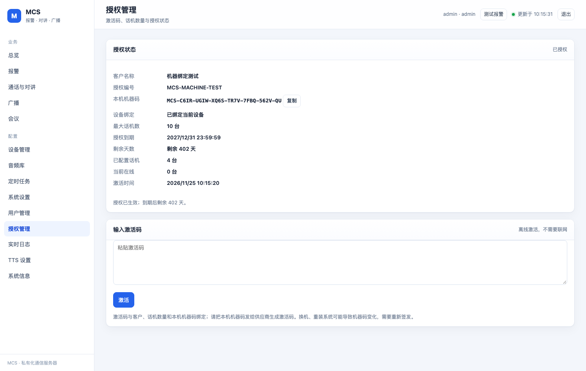

# MCS 授权管理

## 1. 授权方式

MCS 使用**离线激活码**，不需要联网。

- 未激活：试用授权，最多 **4 台话机在线**；
- 激活后：按激活码中的话机数量授权；
- 激活码由供应商使用 Ed25519 私钥签名；
- MCS 内置公钥验证，伪造/篡改的激活码会被拒绝；
- 激活码保存在 SQLite 中，重启后继续有效。

激活码可以设置**到期时间**：

- 未设置到期时间：永久授权；
- 设置了到期时间：到期后自动转为试用授权（最多 4 台在线），状态显示“已过期”；
- 已过期激活码不能再次激活，需要供应商签发新的续期码；
- 已有在线话机不会被强制踢下线，但新注册会被试用上限限制。

0.12.0 起，激活码**必须绑定机器码**，一机一码，不能在多台服务器通用。

每台 MCS 在“授权管理”页显示本机机器码，例如：

```text
MCS-C6IR-UGIW-XQ6S-TR7V-7FBQ-562V-QU
```

客户把机器码发给供应商，供应商用 `-machine` 签发；激活时 MCS 校验机器码，不一致直接拒绝。

机器码是硬件/系统标识的 SHA-256 摘要，不会上传，只用于本地绑定。

## 2. 网页激活

管理员登录：

```text
配置 → 授权管理
```

页面显示：

- 授权状态：试用 / 已授权；
- 客户名称；
- 授权编号；
- **本机机器码**（可复制）；
- 设备绑定状态；
- 最大话机数；
- 授权到期时间；
- 剩余天数；
- 已配置话机数；
- 当前在线话机数；
- 激活时间。

流程：

1. 客户在页面复制“本机机器码”；
2. 把机器码和客户名称/话机数量发给供应商；
3. 供应商生成绑定该机器码的激活码；
4. 客户把激活码粘贴到“输入激活码”，点击“激活”。

激活码与本机机器码不一致时，页面提示“激活码与本机设备不匹配”。

激活成功后立即生效，不需要重启。



## 3. 话机数量如何限制

同时限制两个维度：

1. **设备总数**：新增设备时，如果已配置设备数达到授权上限，拒绝新增；
2. **并发在线数**：SIP 注册时，如果当前在线话机数达到上限，新话机注册返回 `403 Forbidden`。

已有在线话机不会被强制踢下线；授权数量降低后，在线数量可能暂时超过上限，但新注册会被拒绝。

从 `config.yaml` 首次导入的设备可能超过授权数量，此时：

- 已有设备保留；
- 新增设备被拒绝；
- 只允许不超过授权数量的设备同时在线。

## 4. 供应商生成激活码

源码自带工具：

```bash
go run ./cmd/mcs-license \
  -key .license/mcs-license-private.key \
  -customer "客户名称" \
  -max-phones 50 \
  -license-id MCS-2026-001 \
  -machine "MCS-C6IR-UGIW-XQ6S-TR7V-7FBQ-562V-QU" \
  -expires 2027-12-31
```

`-expires` 可省略，表示永久授权；也可以传 RFC3339 时间。

输出：

```text
eyJ2IjoxLC...
```

把这个字符串发给客户，在“授权管理”中激活。

参数：

| 参数 | 说明 |
| --- | --- |
| `-key` | Ed25519 私钥文件 |
| `-customer` | 客户名称 |
| `-max-phones` | 最大话机数量 |
| `-machine` | **必填**，客户页面显示的本机机器码 |
| `-license-id` | 授权编号，便于对账 |
| `-issued-at` | 可选，签发时间 |
| `-expires` | 可选，到期日期（YYYY-MM-DD）或 RFC3339；省略为永久 |
| `-out` | 可选，把激活码写入文件 |

### 私钥安全

私钥文件：

```text
.license/mcs-license-private.key
```

该目录已加入 `.gitignore`，不会提交到仓库。

请务必备份到离线安全位置：

- 私钥丢失后无法再生成新激活码；
- 已发出的激活码仍然有效；
- 不要把私钥发给客户；
- 不要提交到 GitHub；
- 建议放在密码管理器或离线加密盘。

当前公钥已经编入程序。更换密钥对需要重新编译 MCS。

## 5. API

```text
GET  /api/v1/license
POST /api/v1/license/activate
```

激活：

```json
{"code":"eyJ2IjoxLC..."}
```

返回：

```json
{
  "license_id":"MCS-2026-001",
  "customer":"客户名称",
  "max_phones":50,
  "effective_max_phones":50,
  "machine_code":"MCS-C6IR-UGIW-XQ6S-TR7V-7FBQ-562V-QU",
  "machine_bound":true,
  "machine_match":true,
  "expires_at":"2027-12-31T23:59:59+08:00",
  "days_left":402,
  "expired":false,
  "status":"licensed",
  "activated":true,
  "used_phones":12,
  "online_phones":8
}
```

仅 admin 可访问和激活。

## 6. 常见问题

### 激活码无效

- 检查是否完整复制；
- 检查是否来自本产品/本密钥；
- 检查是否被换行或空格截断；
- 检查生成时填写的 `-machine` 是否和当前页面机器码完全一致；
- 旧版未绑定机器的激活码不能使用，需要重新签发。

### 机器码变化了

以下操作可能导致机器码变化：

- 重装操作系统；
- 更换系统盘；
- 虚拟机克隆/迁移；
- Windows 系统准备（sysprep）；
- 主板/BIOS 信息变化。

机器码变化后需要把新机器码发给供应商重新签发。

### 激活后还是被限制

- 查看“已配置话机”是否超过授权数量；
- 如果在线数达到上限，先让不用的设备离线；
- 新增设备会检查设备总数；
- 重启不会丢失授权。

### 想增加话机数量或续期

重新生成一个更大数量/更晚到期时间的激活码，重新激活即可。新激活码会覆盖旧授权。

### 授权到期后会发生什么

- 状态变为“已过期”；
- 最大话机数按试用授权 4 台执行；
- 已在线话机不会被强制踢下线；
- 新话机注册、新增设备会被拒绝；
- 重新激活未过期的新码即可恢复。

### 想换服务器

旧激活码只绑定旧机器码，不能直接复用。需要提供新服务器机器码，重新签发。

### 删除数据库会怎样

授权信息存放在 SQLite 的 settings 表中。删除数据库会回到 4 台试用授权，需要重新激活。

## 7. 当前边界

- 无自动续费；到期需要重新签发激活码；
- 机器码绑定是离线硬件摘要，不是强 DRM；
- 虚拟机克隆可能复制相同机器码，需要避免克隆部署；
- 无在线吊销；
- 无浮动授权服务器；
- 通过修改程序绕过授权不在防护范围内。

授权是商业交付的合规控制，不是强 DRM。

## 8. 升级兼容

0.11.0 及以前的激活码没有机器字段，升级到 0.12.0 后会被拒绝：

```text
该激活码是旧版通用授权，未绑定设备；请使用本机机器码重新签发
```

客户升级前应：

1. 打开授权页复制新机器码；
2. 供应商重新签发绑定码；
3. 升级后激活新码。

已配置设备、授权页显示、到期时间等数据不会因为升级丢失；只是旧通用码不再生效。
