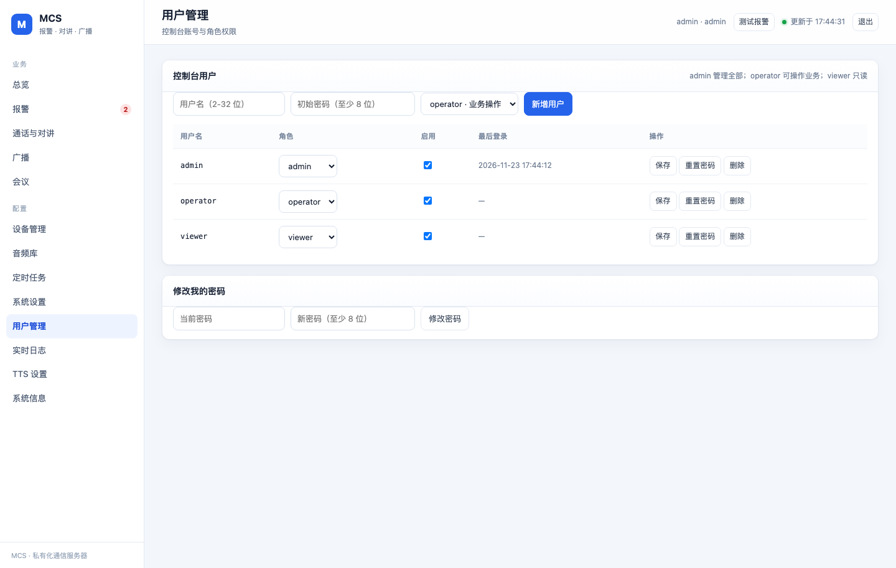

# MCS 控制台用户与权限

## 1. 角色

| 角色 | 权限 |
| --- | --- |
| `admin` | 全部：用户、系统设置、重启、TTS、设备、广播、报警 |
| `operator` | 业务操作：报警处置、对讲/开锁、广播、设备、音频、定时任务；不能改用户/网络/重启 |
| `viewer` | 只读：总览、设备、通话、报警、日志；所有写操作 403 |

前端会隐藏非 admin 的系统设置/用户管理/TTS 入口，后端仍会做权限校验。



## 2. 首次启动与管理账号

### 配置了 `auth.console_password`

首次启动且用户表为空时，创建：

```text
username = auth.console_user（默认 admin）
password = auth.console_password
role     = admin
```

之后修改 `config.yaml` 的密码不会再影响已有用户，请在用户管理里重置。

### 没有配置 `auth.console_password`

首次启动生成随机管理员密码并写到：

```text
<data_dir>/initial-admin.txt
```

Windows 默认：

```text
C:\ProgramData\MCS\data\initial-admin.txt
```

文件内容包含用户名和临时密码。请登录后立即改密并删除该文件。

控制台不再允许“无密码直接操作”。

## 3. 用户管理

配置 → 用户管理：

- 新增用户；
- 修改角色；
- 启用/禁用；
- 重置密码；
- 删除用户；
- 修改自己的密码。

保护：

- 不能删除当前登录用户；
- 不能移除自己的 admin 角色；
- 至少保留一个启用的管理员；
- 禁用/删除/重置密码会使该用户已有会话失效；
- 角色变更在下一次请求立即生效。

## 4. API

```text
GET    /api/v1/users
POST   /api/v1/users
PATCH  /api/v1/users/{username}
DELETE /api/v1/users/{username}
POST   /api/v1/me/password
```

登录：

```text
POST /api/v1/login
GET  /api/v1/session
POST /api/v1/logout
```

## 5. 安全边界

已实现：

- bcrypt 密码哈希（先 SHA-256，避免 bcrypt 72 字节截断）；
- Cookie 会话，HttpOnly + SameSite=Strict；
- 12 小时会话；
- admin/operator/viewer 角色；
- 会话与数据库用户状态联动。

建议下一步：

- 登录失败限速/锁定；
- 审计日志（登录、用户、配置、广播、开门、报警）；
- 会话空闲超时；
- 首次登录强制改密；
- HTTPS 强制和 API Token。

## 5.1 页面提示 `/api/v1/devices HTTP 401`

这是**未登录/会话失效**，不是设备 API 故障。

新装或升级后：

1. 页面应自动弹出登录框；
2. 如果还显示旧页面，按 `Ctrl+F5` 强制刷新；
3. 首次安装没有配置 `console_password` 时，查看：

```text
<data_dir>/initial-admin.txt
```

Windows 默认：

```text
C:\ProgramData\MCS\data\initial-admin.txt
```

4. 账号密码登录后 401 会消失；
5. 重装/重启会清空内存会话，浏览器旧 Cookie 失效，必须重新登录。

新版已关闭控制台页面缓存，并在 API 返回 401 时自动弹出登录框。

## 6. 忘记管理员密码

如果配置了 `console_password` 且用户表为空，重新启动可重新创建。

如果已有用户但密码丢失：

1. 停止 MCS；
2. 备份 `data/mcs.db`；
3. 用 SQLite 删除 `users` 表或对应 admin 行并重启，会重新走首次创建；
4. 不建议直接改 hash。

生产环境建议保留至少两个管理员。
