# MCS 用户使用手册

**适用版本：MCS 0.16.0**  
**文档版本：2026-11-23**

---

## 1. 产品概述

MCS 是一套面向**报警、对讲、广播**场景的 SIP 融合通信服务器。

它把报警呼叫、门口机对讲、分区广播、实时寻呼、电话会议、录音和终端管理集中在一个网页控制台中，适合小区、园区、工厂、学校、医院、酒店、停车场、指挥中心等场景。

### 1.1 主要功能

| 功能 | 说明 |
| --- | --- |
| 设备管理 | SIP 终端注册、在线状态、租期、删除、抓拍地址 |
| 报警 | 报警呼叫、逐级升级、事件处置、测试报警 |
| 通话与对讲 | 点对点通话、视频对讲、WebRTC 查看、开锁、抓拍、话单、录音 |
| 广播 | TTS 广播、音频库广播、分区/全区、优先级抢占、定时任务 |
| 实时寻呼 | SIP 话机或网页麦克风对分区实时讲话、PIN、权限、记录 |
| 电话会议 | 网页建房、多人音频混音、H264 视频、WebRTC 网页加入、录音 |
| 控制台 | 总览、系统设置、用户权限、实时日志、TTS 设置、系统信息 |
| 安全 | 控制台账号/RBAC、SIP TLS、HTTPS、SRTP（按终端支持） |

### 1.2 三类使用人员

| 角色 | 主要工作 |
| --- | --- |
| 值班人员 | 接报警、接对讲、听广播、发起寻呼、加入会议 |
| 操作员 | 设备、广播、寻呼、会议、报警处置 |
| 管理员 | 系统设置、用户管理、TTS、重启、全部业务 |

### 1.3 控制台界面

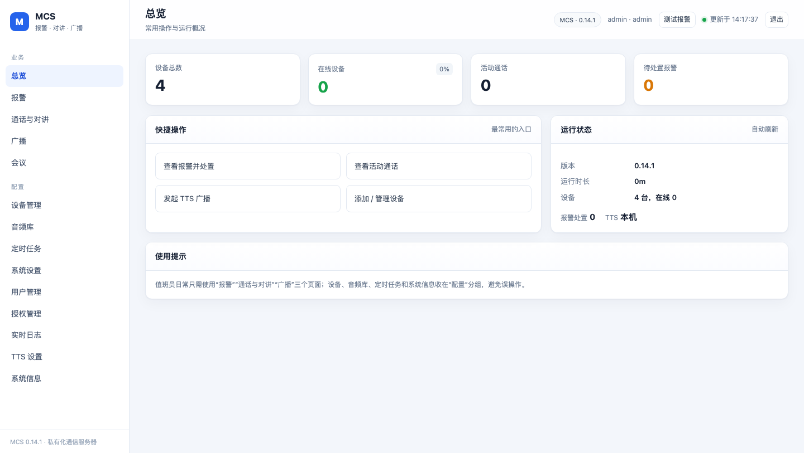

左侧导航分为：

- **业务**：总览、报警、通话与对讲、广播、会议；
- **配置**：设备管理、音频库、定时任务、系统设置、用户管理、实时日志、TTS 设置、系统信息。

右上角显示当前账号、测试报警、更新时间和退出。

---

## 2. 快速开始

### 2.1 登录

用浏览器打开 MCS 控制台地址，例如：

```text
http://192.168.1.10:8080/
```

如果页面没有登录，会自动弹出登录框。

- 用户名：通常是 `admin`；
- 密码：首次安装生成在 `<data_dir>/initial-admin.txt`，或使用管理员配置的 `console_password`。

Windows 安装版默认数据目录：

```text
C:\ProgramData\MCS\data
```

因此初始密码文件通常是：

```text
C:\ProgramData\MCS\data\initial-admin.txt
```

登录后右上角显示：

```text
admin · admin    退出
```

### 2.2 首次检查

登录后建议按顺序检查：

1. **系统设置**：设备访问 IP、SIP 端口、HTTP 端口是否正确；
2. **设备管理**：设备是否注册、是否在线；
3. **广播分区**：分区和寻呼短号是否正确；
4. **TTS 设置**：TTS 服务是否可用；
5. **用户管理**：是否需要新增 operator/viewer 账号。

### 2.3 常用入口

| 要做的事 | 页面 |
| --- | --- |
| 看设备在线情况 | 设备管理 / 总览 |
| 处理报警 | 报警 |
| 接对讲、看视频、开锁 | 通话与对讲 |
| 发 TTS/音频广播 | 广播 |
| 实时喊话 | 广播 → 网页实时寻呼 |
| 多人开会 | 会议 |
| 创建用户 | 用户管理 |
| 看运行日志 | 实时日志 |
| 修改端口/IP | 系统设置 |

---

## 3. 账号与权限

### 3.1 角色

| 角色 | 权限 |
| --- | --- |
| admin | 全部功能，包括系统设置、用户管理、重启、TTS、服务器设置 |
| operator | 业务操作：报警处置、设备、广播、寻呼、会议、对讲；不能改系统设置和用户 |
| viewer | 只读查看；不能发起广播、寻呼、会议操作、对讲控制 |

### 3.2 新增用户

管理员进入：

```text
配置 → 用户管理 → 新增用户
```

填写：

- 用户名：2-32 位；
- 初始密码：至少 8 位；
- 角色：admin / operator / viewer。

创建后请把账号和初始密码交给使用人，并提醒首次登录后修改密码。

### 3.3 修改自己的密码

```text
配置 → 用户管理 → 修改我的密码
```

输入当前密码和新密码。

### 3.4 账号安全建议

- 不要多人共用 admin；
- 值班人员使用 operator；
- 只读展示屏使用 viewer；
- 定期更换密码；
- 离职人员及时禁用或删除；
- 初始管理员密码修改后删除 `initial-admin.txt`。

---

## 4. 总览

“总览”用于快速查看系统状态：

- 设备总数；
- 在线设备数；
- 报警事件；
- 活动通话；
- 最近话单；
- 活动广播；
- 系统更新时间。

总览每 2 秒自动刷新。设备、报警、通话状态以服务端为准。

---

## 5. 设备管理

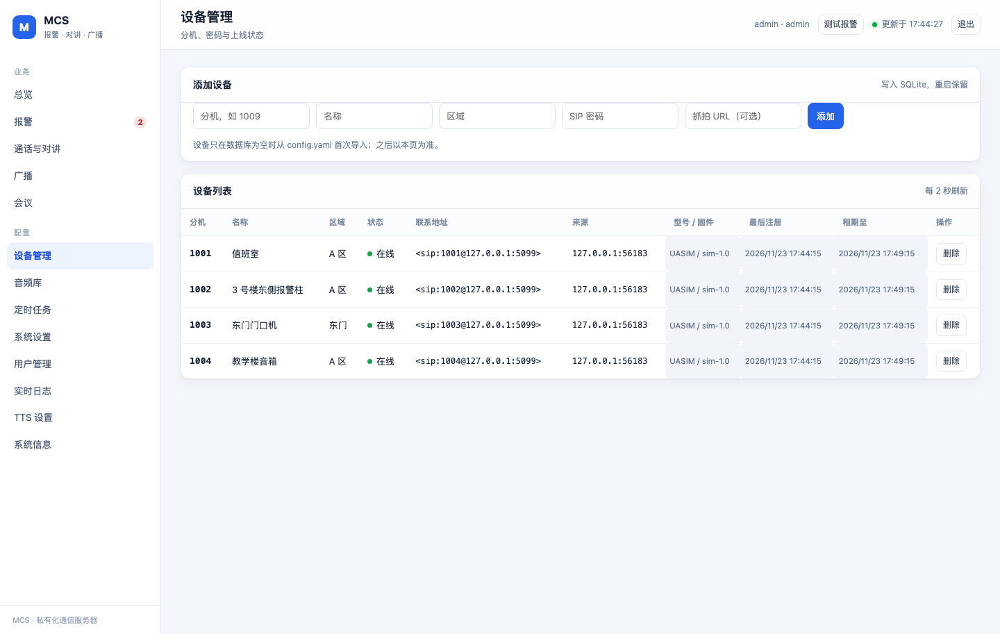

### 5.1 添加设备

进入：

```text
配置 → 设备管理 → 添加设备
```

填写：

| 字段 | 说明 |
| --- | --- |
| 分机 | SIP 分机号，例如 1001 |
| 名称 | 例如“北门门口机” |
| 区域 | 例如“北区” |
| SIP 密码 | 终端注册密码 |
| 抓拍 URL | 可选，HTTP 图片地址，用于抓拍按钮 |

点击“添加”。设备保存到 SQLite，重启后保留。

### 5.2 设备列表

列表显示：

- 分机、名称、区域；
- 在线/离线；
- Contact 地址；
- 注册来源；
- 型号/固件（终端上报时显示）；
- 最后注册时间；
- 租期至；
- 编辑/删除按钮。

点击“编辑”可以修改：

- 名称；
- 区域；
- SIP 密码；
- 抓拍 URL。

SIP 密码留空表示不修改。修改密码后，该设备会立即离线，话机上的 SIP 密码也要同步修改，然后用新密码重新注册。

### 5.3 SIP 终端配置

在话机、门口机、音箱中配置：

```text
SIP 服务器：MCS 的 IP
SIP 端口：5060（或实际配置）
传输：UDP / TCP / TLS
账号：设备分机
密码：设备密码
```

音频编码建议：

- PCMU；
- PCMA。

视频对讲设备还需支持：

- H264；
- SIP INVITE；
- RTP/RTCP。

### 5.4 SIP TLS / HTTPS / SRTP 设置

管理员可以在网页直接配置，不需要编辑 `config.yaml`：

```text
配置 → 系统设置 → 服务器设置
```

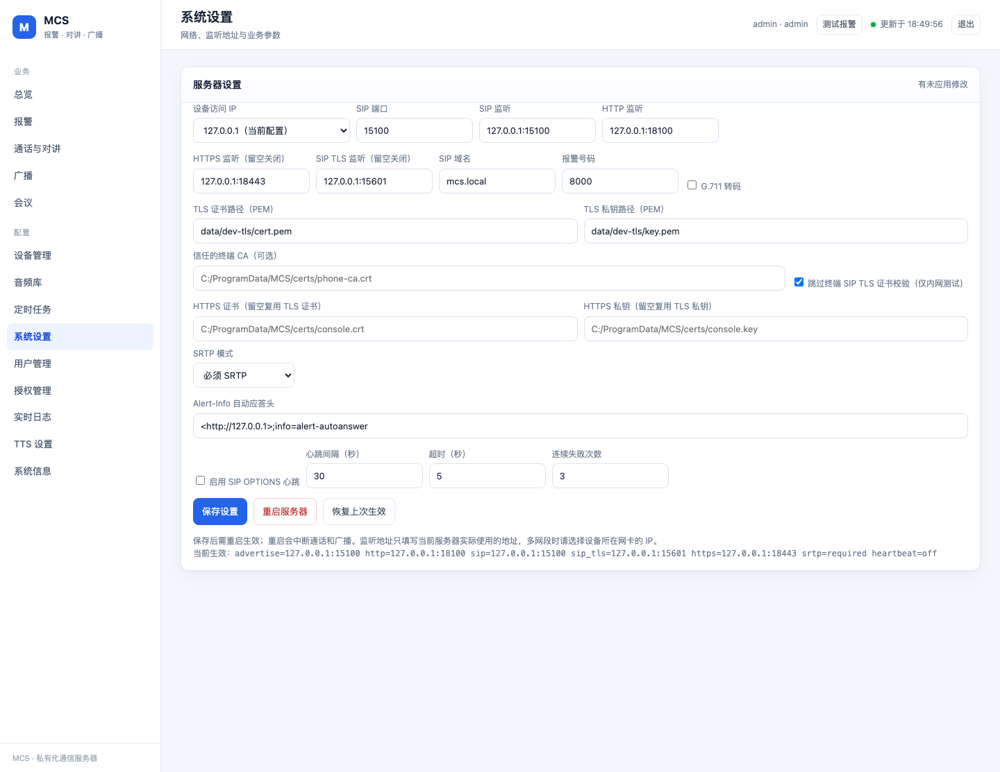

可设置：

- SIP TLS 监听，例如 `0.0.0.0:5061`；
- TLS 证书和私钥路径（PEM）；
- 信任的终端 CA；
- 内网测试可勾选“跳过终端 SIP TLS 证书校验”；
- HTTPS 监听、HTTPS 证书/私钥；
- SRTP 模式：自动 / 必须 / 关闭。

保存后点击“重启服务器”生效。

终端使用 TLS 时：

```text
SIP 端口：5061
传输：TLS
```

SRTP 是终端在 SDP 中协商的：

```text
m=audio ... RTP/SAVP 0
a=crypto:1 AES_CM_128_HMAC_SHA1_80 inline:...
```

注意：

- 只支持 SDES-SRTP，不支持 SIP 终端 DTLS-SRTP；
- SRTP 模式只作用于点对点通话和报警呼叫；
- 广播、寻呼、会议仍使用明文 RTP；
- SDES 密钥在 SDP 中，生产环境应同时启用 SIP TLS。

### 5.5 ICE / STUN / TURN

默认 WebRTC 只使用 host candidate，适合同一局域网。

需要跨网段/公网时，在“系统设置”配置：

- STUN 地址；
- TURN 地址；
- TURN 用户名/密码；
- WebRTC 公网 IP（可选）。

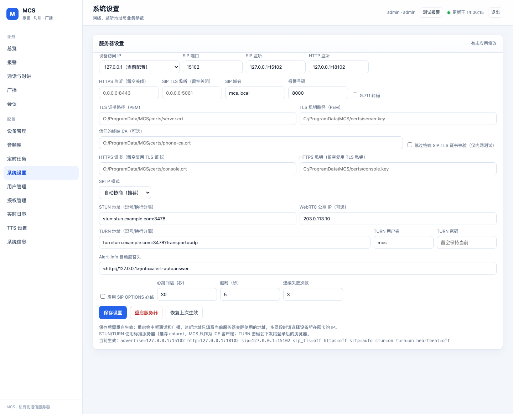

示例：

```text
STUN：stun:stun.example.com:3478
TURN：turn:turn.example.com:3478?transport=udp
TURN 用户名：mcs
TURN 密码：******
```

说明：

- STUN/TURN 使用标准服务，不需要在 MCS 里单独开发；
- 推荐部署 coturn，TURN 同时提供 STUN；
- MCS 和浏览器都需要能访问 TURN；
- TURN 需要公网 IP、3478 UDP/TCP 和中继端口范围；
- 公网 IP 字段用于服务器在 NAT 后时发布 host candidate；
- TURN 密码会下发给登录后的浏览器，建议使用专用账号。

SIP 话机侧仍不使用 ICE/STUN/TURN，只走 RTP 中继和地址锁存。

### 5.6 在线与租期

MCS 按注册租期判断在线：

- 默认租期 300 秒；
- 设备应在租期到期前重新注册；
- 租期到期未续注册，显示离线；
- 可启用 SIP OPTIONS 心跳加快离线检测。

心跳配置在“系统设置”，默认关闭。

### 5.7 删除设备

在设备列表点击“删除”。

删除后：

- 设备不能再注册；
- 历史话单和录音仍保留；
- 需要重新添加才能恢复。

---

## 6. 报警

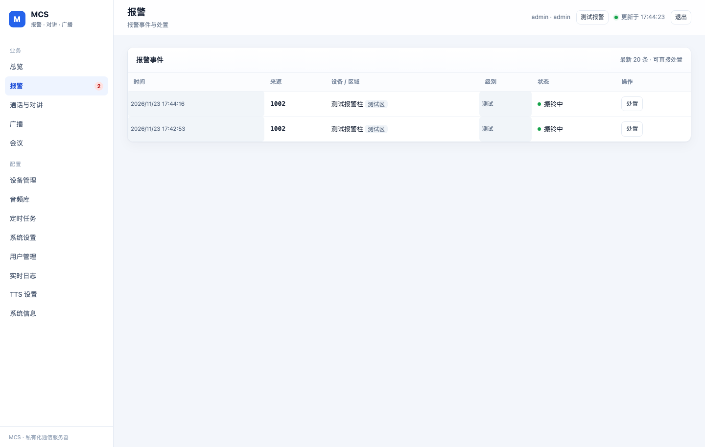

### 6.1 报警流程

典型流程：

```text
报警设备呼叫报警号码（默认 8000）
        ↓
MCS 按报警级别依次呼叫值班目标
        ↓
接通后双方通话
        ↓
未接通则升级到下一级
        ↓
控制台生成报警事件
```

报警号码在“系统设置 → 报警号码”中配置。

### 6.2 报警事件

进入“报警”页面：

- 查看报警时间、设备、区域、级别、接听人、状态；
- 点击“处置”关闭事件；
- 事件关闭后不再出现在待处理列表。

### 6.3 测试报警

右上角“测试报警”用于验证：

- 报警事件能否生成；
- 值班人员能否收到；
- 报警录音和话单是否正常。

测试前应确认不会影响真实值班。

### 6.4 报警级别

管理员在配置文件中设置报警级别和目标：

```yaml
alarm:
  number: "8000"
  levels:
    - name: "一级"
      members: ["1001", "1002"]
      timeout_s: 20
    - name: "二级"
      members: ["1003"]
      timeout_s: 30
```

实际配置以现场为准。修改后需要重启 MCS。

---

## 7. 通话与对讲

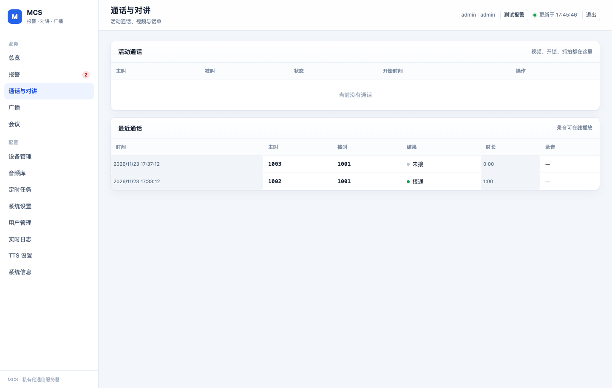

### 7.1 点对点通话

设备之间、设备与话机之间可以直接拨分机号。

MCS 作为 B2BUA：

- 建立主叫和被叫两条腿；
- 转发 RTP；
- 生成话单；
- 按配置录音。

### 7.2 视频对讲

带 H264 的门口机呼叫值班室：

1. 值班室话机接听，或浏览器打开视频；
2. “通话与对讲”页面显示活动通话；
3. 点击“视频”只查看和收听，不会打开浏览器麦克风；
4. 只有门口机通话才显示“视频对讲”，点击后才会打开麦克风与门口机对讲。

浏览器视频窗支持：

- 查看门口机视频；
- 接收门口机音频；
- “视频对讲”模式下才回传浏览器麦克风；
- 关闭视频窗结束查看。

> 普通报警通话/分机通话只显示“视频”，不会启用浏览器麦克风，避免把电脑环境噪声送进通话。

### 7.3 开锁

通话中点击“开锁”，MCS 向门口机发送 DTMF INFO。

默认开锁指令：

```text
#
```

不同门口机可能使用 `*` 或其他指令，以设备说明为准。

### 7.4 抓拍

设备配置了“抓拍 URL”后，通话中点击“抓拍”会打开该 URL 的图片。

URL 由设备厂家提供，通常是：

```text
http://设备IP/snapshot.jpg
```

### 7.5 活动通话

显示：

- 主叫、被叫；
- 通话状态；
- 开始时间；
- 视频/开锁/抓拍按钮。

### 7.6 话单与录音

“通话与对讲”页面下方显示最近话单：

| 字段 | 说明 |
| --- | --- |
| 开始 | 通话开始时间 |
| 主叫 | 发起方 |
| 被叫 | 接收方 |
| 结果 | 接通/未接/忙/失败/取消 |
| 时长 | 通话时长 |
| 录音 | 有录音时显示“播放” |

录音文件保存在数据目录的 `recordings/` 下。

---

## 8. 广播

广播用于向一个或多个分区播放**单向音频**。

页面：

```text
业务 → 广播
```

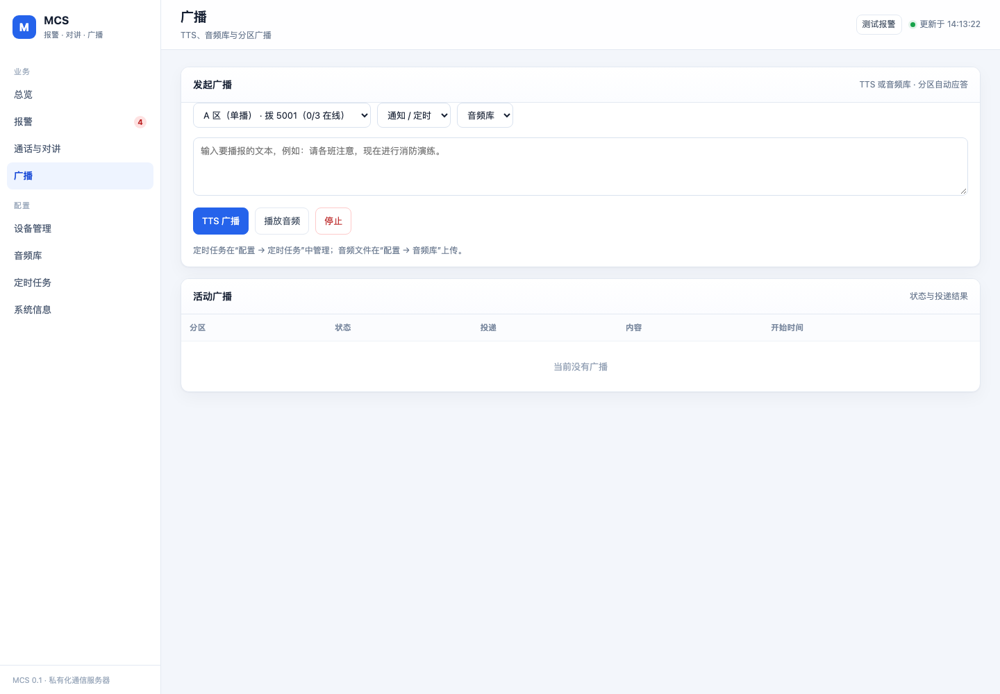

### 8.1 TTS 广播

1. 选择分区；
2. 选择优先级；
3. 输入播报文本；
4. 点击“TTS 广播”。

MCS 调用 TTS 服务生成语音，再向分区终端播放。

TTS 服务在：

```text
配置 → TTS 设置
```

配置。

### 8.2 音频库广播

1. 进入“配置 → 音频库”上传 WAV/MP3；
2. 回到“广播”；
3. 选择音频；
4. 点击“播放音频”。

音频库支持：

- WAV；
- MP3；
- 上传、试听、删除。

### 8.3 优先级

广播支持优先级：

| 优先级 | 用途 |
| --- | --- |
| 紧急 | 最高，可抢占普通广播 |
| 实时 | 实时通知 |
| 通知/定时 | 日常通知 |
| 背景音乐 | 最低 |

高优先级广播可以抢占低优先级广播。具体是否抢占取决于分区当前状态。

### 8.4 实时寻呼

实时寻呼是值班人员**现场说话**，不是预录内容。

两种方式：

#### 方式一：SIP 话机

拨打分区寻呼短号，例如：

```text
5001
```

接通后直接讲话，挂机结束。

#### 方式二：网页麦克风

```text
广播 → 网页实时寻呼
```

1. 选择分区；
2. 如配置了 PIN，输入 PIN；
3. 点击“开始网页寻呼”；
4. 允许麦克风；
5. 讲话；
6. 点击“停止”。

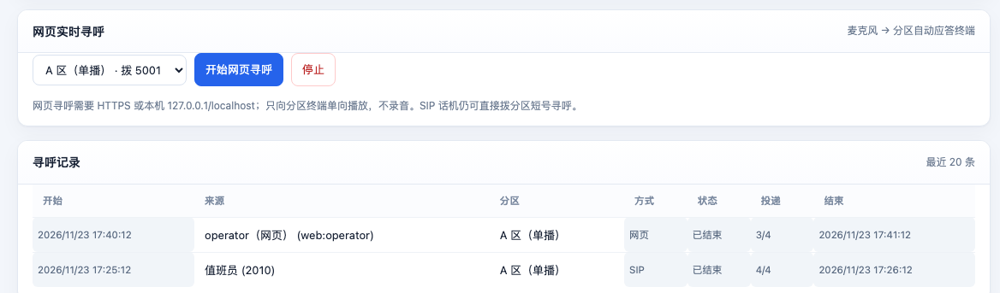

要求：

- HTTPS 或本机 `127.0.0.1/localhost`；
- 分区有在线自动应答终端；
- 终端支持自动接听。

寻呼记录在广播页下方查看：

- 来源；
- 分区；
- SIP/网页；
- 状态；
- 投递数；
- 开始/结束时间。

寻呼与 TTS 广播的区别：

- 寻呼是真人现场讲话；
- TTS/音频是预生成内容；
- 寻呼挂机即结束；
- TTS/音频播放完自动结束。

### 8.5 定时任务

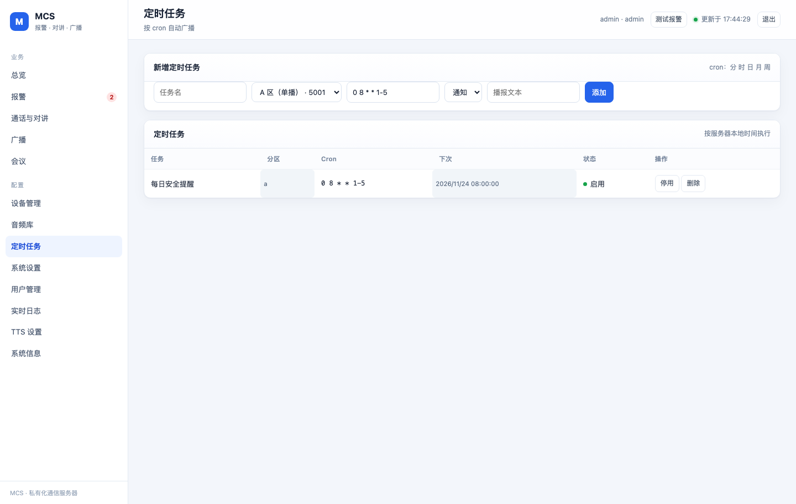

进入：

```text
配置 → 定时任务
```

创建定时广播：

- 任务名；
- 分区；
- cron：分 时 日 月 周；
- 优先级；
- 播报文本。

支持启停、删除。定时任务按服务器本地时间执行。

示例：

```text
0 8 * * 1-5
```

表示工作日每天 8:00。

### 8.6 网页分区管理

管理员可以直接在网页管理广播分区，不必手工编辑 `config.yaml`：

```text
业务 → 广播 → 广播分区管理
```

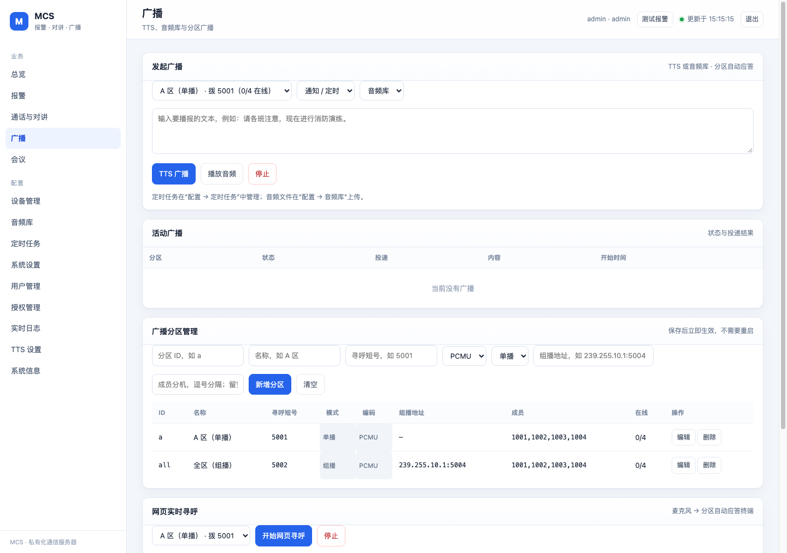

可以新增/编辑/删除：

- 分区 ID；
- 名称；
- 寻呼短号；
- 编码：PCMU / Opus；
- 模式：单播 / 组播；
- 组播地址和端口；
- 成员分机；留空表示所有设备。

保存后立即生效，不需要重启。配置保存到 SQLite，重启后保留。

注意：

- 分组正在广播时不能编辑或删除；
- 至少保留一个分区；
- 组播地址必须是合法的 `239.x.x.x` 类地址；
- 分区配置首次来自 `config.yaml`，之后以网页/数据库为准。

### 8.7 广播终端要求

分区终端需要：

- 注册到 MCS；
- 支持自动应答；
- 支持 PCMU 或 PCMA；
- 组播分区还需加入对应组播组。

普通软电话通常需要人工接听，不建议作为广播终端。

---

## 9. 电话会议

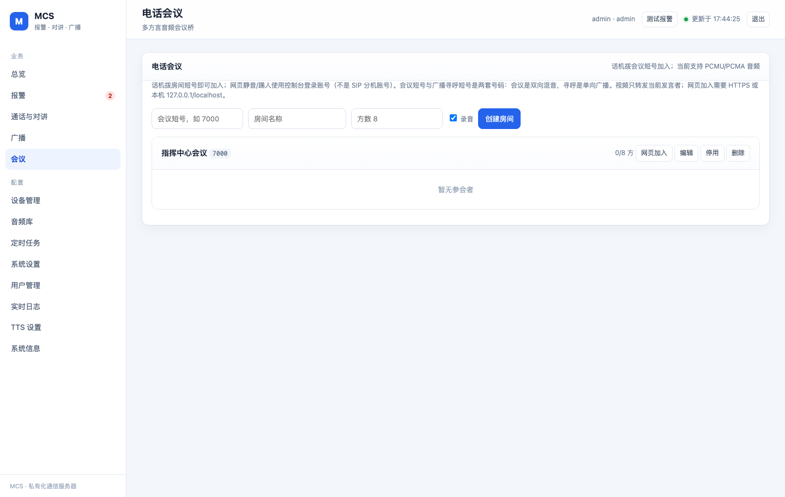

### 9.1 创建会议房间

管理员进入：

```text
业务 → 会议
```

填写：

- 会议短号，例如 `7000`；
- 房间名称；
- 最大方数，默认 8，最大 16；
- 是否录音。

点击“创建房间”。

房间保存到 SQLite，立即生效，不需要重启。

管理员还可以：

- 编辑房间；
- 启用/停用；
- 删除空房间；
- 查看录音链接。

### 9.2 加入会议

#### SIP 话机

直接拨会议短号：

```text
7000
```

#### 网页加入

会议房间右侧点击“网页加入”：

1. 浏览器请求麦克风和摄像头；
2. 允许后加入；
3. 网页麦克风进入会议混音；
4. 网页摄像头可以成为会议视频源；
5. 网页显示当前发言者视频。

网页会议需要：

- HTTPS；
- 或本机 `127.0.0.1/localhost`；
- 浏览器支持 H264 和 PCMU/PCMA。

### 9.3 会议操作

在会议页面：

- 查看参会者；
- 静音/取消静音；
- 踢出；
- 查看媒体类型（音频/视频）；
- 查看加入时间。

权限：

- admin/operator 可静音、踢人；
- viewer 只读；
- 房间创建、编辑、删除仅 admin。

### 9.4 会议媒体

音频：

- PCMU/PCMA 8kHz；
- 服务器混音；
- 每方听其他方，不听自己。

视频：

- H264；
- 只转发当前发言者；
- 不是多画面合成；
- 需要终端/浏览器支持 H264。

会议录音：

- 混音音频生成 WAV；
- 不包含视频；
- 房间启用录音后生效。

### 9.5 会议音频处理

管理员在“会议”页面下方可以调整会议音频处理，保存后立即生效，不需要重启。

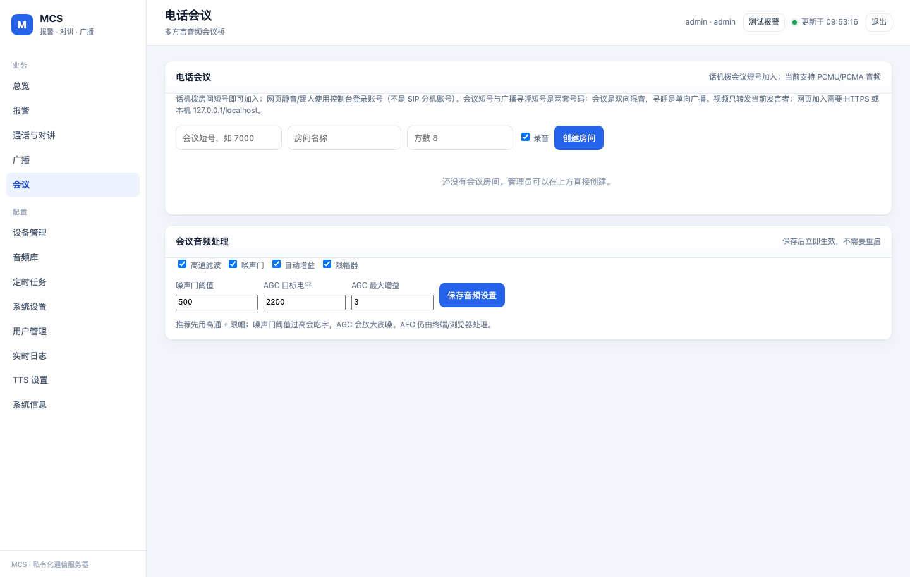

| 选项 | 作用 | 建议 |
| --- | --- | --- |
| 高通滤波 | 去除低频轰鸣、空调低频噪声 | 建议开启 |
| 噪声门 | 压低持续的环境底噪 | 从阈值 400 开始，过高会吃字 |
| 自动增益 | 自动调整参会者音量 | 现场需要时开启，会放大底噪 |
| 限幅器 | 防止多人混音削波、电音 | 建议开启 |

可调参数：

- 噪声门阈值：50-4000，默认 400；
- AGC 目标电平：500-12000，默认 2200；
- AGC 最大增益：1-16，默认 4。

建议先用“高通 + 限幅”，再根据现场决定是否开启噪声门和 AGC。

> 服务器不做 AEC。回声消除由 SIP 会议麦克风/话机自身或 WebRTC 浏览器完成；网页加入会议时，浏览器会请求 AEC、噪声抑制和自动增益。

### 9.6 会议限制

- 默认 8 方，最大 16；
- 没有会议 PIN；
- 没有主持人角色；
- 没有多画面；
- 不支持 Opus/SRTP 会议；
- WebRTC 跨 NAT 需要 STUN/TURN；可在系统设置配置外部 STUN/TURN。

---

## 10. 系统配置

### 10.1 服务器设置

进入：

```text
配置 → 系统设置
```

页面顶部先显示“当前监听与能力”：

- SIP UDP / SIP TCP / SIP TLS 是否启用及地址；
- HTTP / HTTPS 控制台地址；
- RTP/RTCP 为动态 UDP；
- SRTP 当前模式；
- WebRTC ICE 的 STUN/TURN 配置；
- TURN 是否为外部服务。

可配置：

- 设备访问 IP；
- SIP 端口；
- SIP UDP、SIP TCP、SIP TLS 监听地址；
- HTTP、HTTPS 监听地址；
- TLS/HTTPS 证书和私钥；
- 终端 CA；
- SRTP 模式；
- STUN/TURN；
- SIP 域名；
- 报警号码；
- G.711 转码；
- Alert-Info 自动应答；
- SIP OPTIONS 心跳；
- 心跳间隔、超时、失败次数。

证书可以直接上传：

```text
选择类型 → 选择文件 → 上传到服务器
```

上传后自动填入对应路径，再点击“保存设置”。

保存后如果配置有变化，页面顶部会显示橙色提示：

```text
配置已保存，但必须重启服务器后才生效。
```

可以点“立即重启”或“稍后”。

证书路径输入框的默认提示会按当前操作系统和数据目录显示，不再固定显示 Windows 路径。

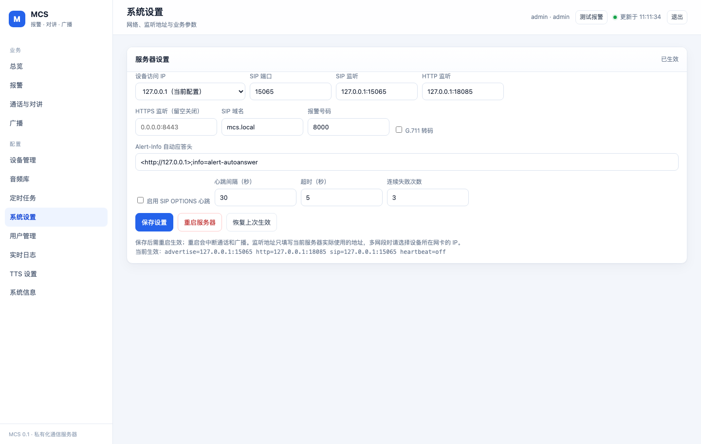

### 10.2 设备访问 IP

“设备访问 IP”是写进 SIP 消息和 SDP 的 MCS 地址。

必须填写设备实际能访问到的服务器 IP。

多网卡服务器如果选错 IP，可能出现：

- 设备注册成功但呼叫无声音；
- SDP 地址不可达；
- 视频/广播不到终端。

修改后需要重启。

### 10.3 报警号码

默认：

```text
8000
```

设备呼叫该号码触发报警流程。

### 10.4 G.711 转码

默认关闭。

只有在两端编码不一致时才需要开启：

- PCMU ↔ PCMA；
- 会占用服务器 CPU；
- 正常同编码通话不需要转码。

### 10.5 心跳

SIP OPTIONS 心跳用于快速发现离线设备。

默认关闭。开启后：

- 定期向在线设备发 OPTIONS；
- 任意 SIP 响应算在线；
- 超时累计失败，达到次数后标记离线；
- 心跳成功会续租。

设备不支持 OPTIONS 或 NAT 只允许设备主动出站时，建议保持关闭。

### 10.6 重启服务器

“系统设置 → 重启服务器”会：

- 中断当前通话、广播、会议；
- 重启 Windows 服务或进程；
- 保存的配置仍然保留。

重启前应确认没有正在进行的紧急业务。

---

## 11. TTS 设置

进入：

```text
配置 → TTS 设置
```

支持：

- OpenAI 兼容接口；
- 千问 DashScope；
- 本地 Kokoro；
- MiniMax。

字段：

| 字段 | 说明 |
| --- | --- |
| Provider | openai 或 minimax |
| Base URL | 接口地址 |
| Model | 模型名 |
| API Key | 密钥；留空保持当前 |
| 中文音色 | 中文 voice |
| 英文音色 | 英文 voice |
| 超时 | 合成超时时间 |

点击“测试合成”验证。

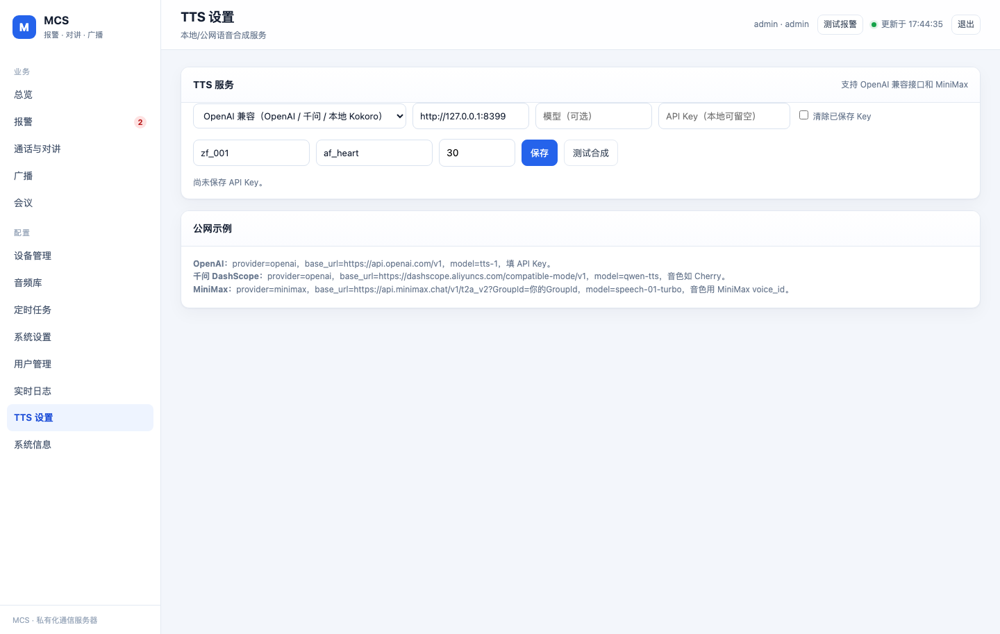

---

## 12. 用户管理

进入：

```text
配置 → 用户管理
```

功能：

- 新增用户；
- 修改角色；
- 启用/停用；
- 删除用户；
- 修改我的密码；
- 查看最后登录时间。

安全限制：

- 不能删除最后一个 admin；
- 不能删除自己；
- 修改角色后会话权限立即生效。

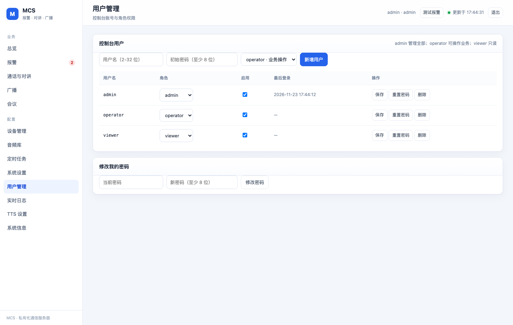

---

## 12.1 授权管理

管理员进入：

```text
配置 → 授权管理
```

查看：

- 授权状态：试用 / 已授权；
- 客户名称；
- 授权编号；
- **本机机器码**；
- 设备绑定状态；
- 最大话机数；
- 授权到期时间；
- 剩余天数；
- 已配置话机数；
- 当前在线话机数；
- 激活时间。

流程：

1. 点击“复制”复制本机机器码；
2. 把机器码、客户名称和话机数量发给供应商；
3. 供应商生成绑定该机器码的激活码；
4. 把激活码粘贴到页面，点击“激活”。

激活码必须和本机机器码一致；不一致会提示“激活码与本机设备不匹配”。

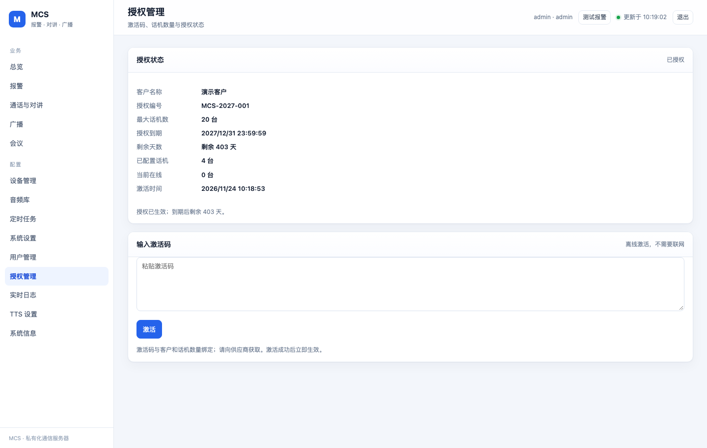

未激活时最多 **4 台话机在线**。激活后：

- 新增设备不能超过授权数量；
- 在线注册话机不能超过授权数量；
- 已有在线话机不会被强制下线。

激活码可以设置到期时间；到期后会转为试用授权（最多 4 台在线），需要供应商重新签发续期码。没有设置到期时间的激活码为永久授权。

激活码一机一码，不能在其他服务器通用。重装系统、更换系统盘、虚拟机克隆等可能导致机器码变化，需要重新签发。

0.11.0 及以前的旧版通用激活码没有绑定机器，升级到 0.12.0 后不能继续使用，需要供应商按新机器码重新签发。

## 13. 实时日志

进入：

```text
配置 → 实时日志
```

功能：

- 查看服务器实时日志；
- 按级别过滤；
- 按关键字过滤；
- 隐藏 HTTP 轮询；
- 暂停刷新；
- 清空显示；
- 复制当前筛选日志；
- 单行右侧“复制”按钮；
- 下载当前筛选日志。

多行异常文本会归一化为一行显示，避免出现多行只有一个字符的异常排版。

用于排查：

- 注册失败；
- 呼叫 486/480；
- 广播失败；
- 会议加入失败；
- 寻呼失败。

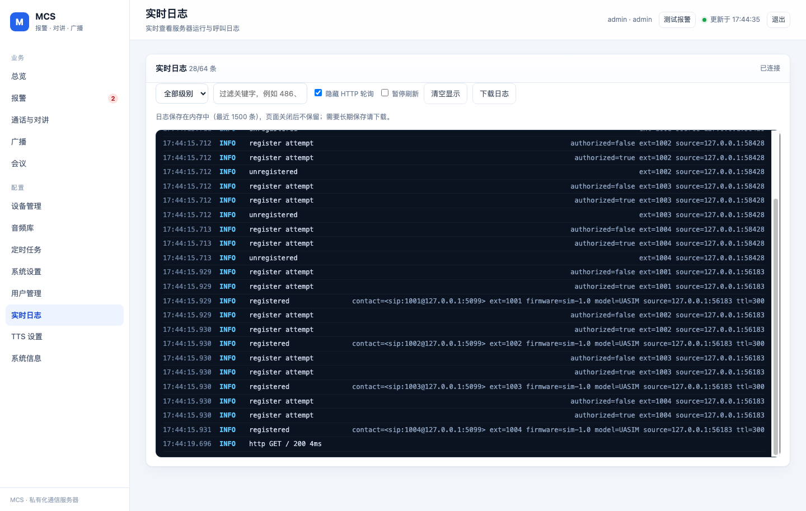

---

## 14. 音频库

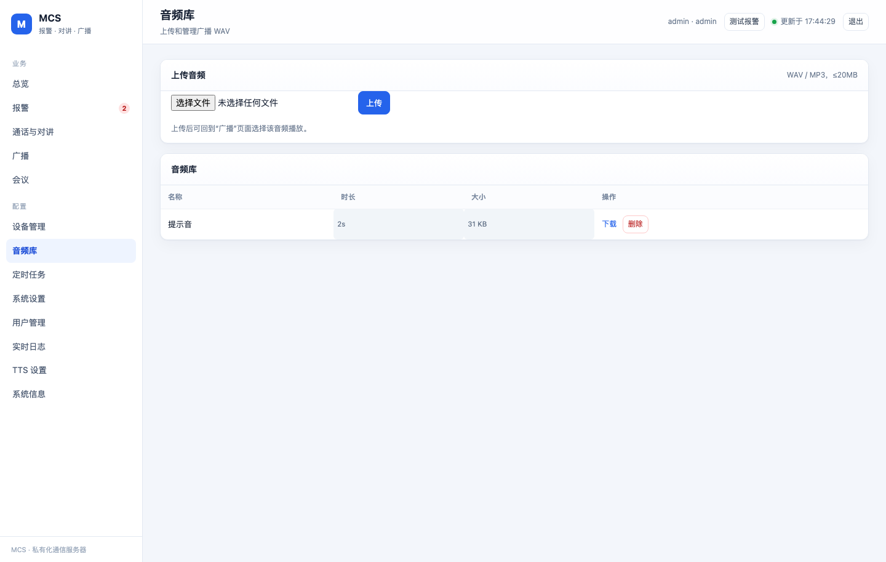

进入：

```text
配置 → 音频库
```

支持：

- 上传 WAV/MP3；
- 试听；
- 删除；
- 在广播页选择播放。

上传后回到“广播”页面选择音频文件。

---

## 15. 系统信息

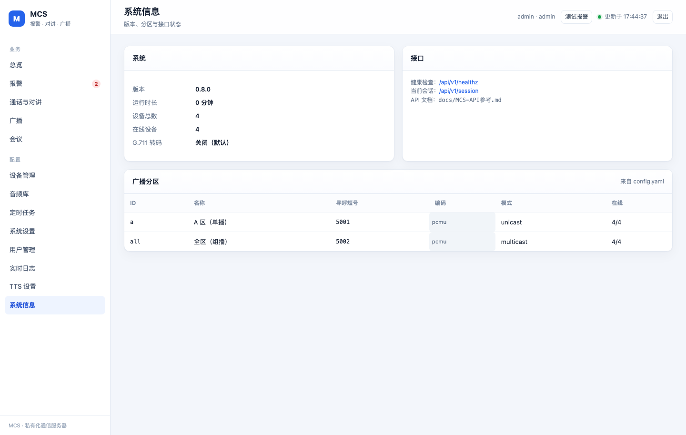

进入：

```text
配置 → 系统信息
```

显示：

- 版本；
- 运行时长；
- 设备总数；
- 在线设备；
- G.711 转码状态；
- 接口地址；
- 广播分区列表。

用于交付验收和远程支持。

---

## 16. 数据备份与升级

### 16.1 数据目录

Windows 默认：

```text
C:\ProgramData\MCS\data
```

包含：

- `mcs.db`：设备、用户、会议房间、寻呼记录等；
- `recordings/`：通话和会议录音；
- `audio/`：音频库、TTS 缓存；
- `initial-admin.txt`：首次管理员密码。

### 16.2 备份

1. 停止 MCS 服务；
2. 复制整个数据目录到备份盘；
3. 再启动服务。

建议定期备份 `mcs.db` 和 `recordings/`。

### 16.3 升级

使用新版安装包覆盖安装：

- 程序文件更新；
- 数据目录默认保留；
- 数据库自动迁移。

升级前建议先备份数据目录。

---

## 17. 常见问题

### 17.1 登录提示 401

表示未登录或会话失效。

处理：

1. `Ctrl + F5` 强制刷新；
2. 查看初始管理员文件；
3. 确认账号密码；
4. 重新登录。

初始密码文件：

```text
C:\ProgramData\MCS\data\initial-admin.txt
```

### 17.2 设备注册不上

检查：

- SIP 服务器 IP/端口；
- 分机、密码；
- 传输协议；
- 防火墙 UDP 5060；
- 设备是否在 MCS 设备列表中。

### 17.2.1 注册认证失败

日志出现：

```text
register auth failed
ext=1003 source=...
```

说明 TLS/网络已经通了，问题在 SIP Digest 账号认证，不是 CA 证书。

按顺序检查：

1. MCS 设备管理中的 SIP 密码和话机密码是否一致；
2. 是否刚改过设备密码，话机是否仍用旧密码；
3. 话机的认证 Realm/SIP 域是否和 MCS“SIP 认证 Realm”一致；
4. 话机用户名是否只填 `1003`，不是 `1003@mcs.local`；
5. 话机注册 URI/域名是否和 MCS 的 SIP 域名一致；
6. 密码是否包含空格、特殊字符或输入错误；
7. MCS 重启后 `auth.secret` 是否为空导致 nonce 失效，重新注册即可。

MCS 新增的失败日志会显示：

```text
auth_user=1003 auth_realm=mcs.local auth_uri=...
request_uri=... expected_realm=mcs
```

如果 `auth_realm` 和 `expected_realm` 不一致，就是 Realm 配错。

系统设置新增：

```text
SIP 认证 Realm
```

默认是 `mcs`。话机中的认证 Realm 必须和它一致，修改后需要重启 MCS。

### 17.2.2 呼叫返回 480

0.14.4 起，MCS 会保留 B 腿的真实 SIP 失败码，不再全部改成 480。

查看“实时日志”：

```text
b-leg response ... code=488
call rejected ... code=488 b_leg_code=488 b_leg_reason=Not Acceptable Here
```

常见：

| B 腿结果 | 含义 |
| --- | --- |
| 486 | 被叫忙 |
| 488 | SDP/媒体不兼容，例如 SRTP、编码、视频参数 |
| 603 | 被叫拒接 |
| 404 | 被叫不存在 |
| 480 | 无人接听/不可达 |
| b_leg_error=TLS... | MCS 到被叫的 TLS 连接失败 |

如果 `b_leg_error` 包含 TLS 握手错误，检查被叫的 SIP TLS 证书、端口和传输方式，不是主叫的 CA 问题。

### 17.2.3 SDP 字段顺序异常

0.16.0 起修复了 SDP 改写中的媒体属性顺序：

```text
m=audio ...
i=...
c=...
b=...
k=...
a=...
```

旧版本可能把 MCS 生成的 `a=crypto` 插在 `m=` 后面，变成：

```text
m=audio ...
a=crypto:...
i=...
c=...
b=...
```

对 SDP 顺序校验严格的终端可能因此解析失败或出现 488。

现在 `a=crypto` 会插入在媒体级固定字段之后、原有属性之前。

### 17.3 能接通但没有声音

检查：

- 设备访问 IP 是否填写正确；
- RTP 端口是否被防火墙拦截；
- 两端编码是否一致；
- 是否开启 G.711 转码；
- 终端音量。

### 17.4 广播没有声音

检查：

- 分区终端是否在线；
- 终端是否自动应答；
- 分区短号/组播地址；
- 终端音量；
- 广播日志。

### 17.5 实时寻呼无法开始

检查：

- 分区在线终端；
- 账号角色；
- PIN；
- 网页是否 HTTPS/本机；
- 麦克风权限；
- 是否分区忙。

### 17.6 会议网页无法加入

检查：

- HTTPS 或本机地址；
- 浏览器麦克风/摄像头权限；
- 浏览器是否支持 H264/PCMU/PCMA；
- 会议房间是否启用；
- 是否已登录 operator/admin。

### 17.7 网页重启失败

如果点击“重启服务器”后页面一直显示“重启后未恢复”：

1. 确认 MCS 是作为 Windows 服务运行，而不是手动运行 `mcs.exe`；
2. 使用安装包中的 `Repair-Service.cmd` 修复服务；
3. 检查 `C:\ProgramData\MCS\mcs.log` 和 `service-error.log`；
4. 服务恢复依赖 Windows 服务恢复策略；
5. 心跳开关本身不会阻止重启；如果开启心跳后才出现，优先检查服务恢复配置和启动日志。

新版已经增加重启辅助进程和 Windows 服务失败恢复标记。

### 17.8 视频窗黑屏

检查：

- 设备是否发送 H264；
- 视频端口是否可达；
- 浏览器是否支持 H264；
- 通话是否带视频 SDP。

### 17.8 报警事件没有生成

检查：

- 设备拨的是否报警号码；
- 报警级别是否配置；
- 设备呼叫是否到达 MCS；
- 实时日志。

---

## 18. 使用限制与安全建议

### 18.1 当前定位

MCS 面向报警、对讲、广播垂直场景，不是通用企业 PBX。

当前不包含：

- IVR；
- 语音信箱；
- 排队；
- BLF/Presence；
- 视频会议多画面；
- 消防认证联动。

### 18.2 视频会议限制

- 视频只转发当前发言者；
- 不是多画面 MCU；
- 只支持 H264；
- 不转码；
- 不支持 SRTP 会议视频；
- WebRTC 跨公网需要配置 STUN/TURN。

### 18.3 广播/寻呼限制

- 寻呼是单向实时讲话；
- 寻呼不录音；
- 广播/寻呼默认明文 RTP；
- 不支持消防应急认证；
- 组播需要网络设备支持 IGMP。

### 18.4 安全建议

- 修改初始管理员密码；
- 使用 operator/viewer 分离权限；
- 控制台启用 HTTPS；
- SIP 网络与办公网络隔离；
- 只允许可信终端访问 MCS；
- 定期备份数据库和录音；
- 不要把 MCS 直接暴露到公网；
- 寻呼 PIN 只发给授权人员。

---

## 19. 快速参考

### 19.1 默认号码

| 功能 | 默认 |
| --- | --- |
| 报警 | 8000 |
| A 区寻呼 | 5001 |
| 全区寻呼 | 5002 |
| 会议房间 | 由管理员创建，例如 7000 |

实际以现场配置为准。

### 19.2 常用页面

| 操作 | 路径 |
| --- | --- |
| 看设备 | 设备管理 |
| 处理报警 | 报警 |
| 看通话 | 通话与对讲 |
| TTS 广播 | 广播 |
| 网页寻呼 | 广播 → 网页实时寻呼 |
| 创建会议 | 会议（admin） |
| 网页会议 | 会议 → 网页加入 |
| 定时任务 | 定时任务 |
| 用户 | 用户管理 |
| 日志 | 实时日志 |
| TTS | TTS 设置 |

### 19.3 快速操作

```text
报警：设备拨 8000
对讲：设备拨值班分机
广播：广播 → 选分区 → TTS/音频
寻呼：拨 5001，或广播 → 网页实时寻呼
会议：拨 7000，或会议 → 网页加入
```

---

## 20. 技术支持

提交问题时请提供：

- MCS 版本；
- 操作时间；
- 相关分机/设备；
- 操作页面和错误提示；
- 实时日志相关片段；
- 话单/录音/寻呼记录；
- 终端型号和固件版本。

---

**MCS · 报警 / 对讲 / 广播融合通信服务器**  
**文档结束**
