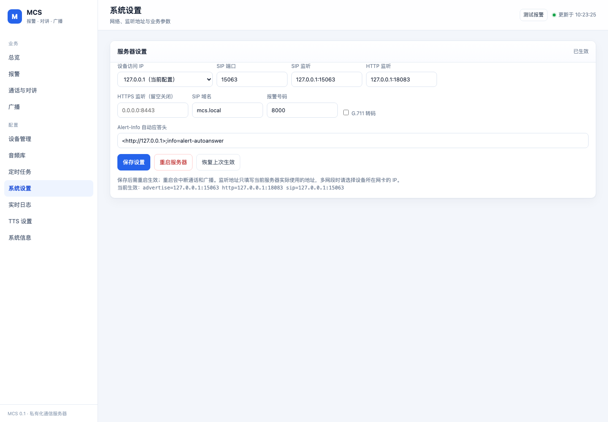

# MCS 系统设置与网页重启

## 1. 系统设置页

配置 → 系统设置：



可修改：

- 设备访问地址 `advertise`；
- SIP UDP 监听地址；
- HTTP/HTTPS 监听地址；
- SIP 域名；
- 报警号码；
- Alert-Info 自动应答头；
- G.711 转码开关。

只允许修改这些**允许列表**字段，不提供任意 YAML 编辑器，避免破坏注释、证书路径和密钥。

## 2. 保存机制

- 保存到 SQLite `settings.server_settings`；
- 启动时覆盖 `config.yaml` 中对应字段；
- 保存后页面显示“有未应用修改”；
- 点击“重启服务器”后生效；
- “恢复上次生效”会把 pending 恢复为当前运行值。

监听地址修改前会做格式、端口范围和新端口占用检查。同一端口只改绑定 IP（如 `127.0.0.1:8080` → `0.0.0.0:8080`）不会预绑定，避免误判为占用。

## 3. 多网段

Windows 双网段时，不要依赖默认路由：

1. 在“设备访问 IP”下拉里选择设备实际所在网卡的 IP；
2. 例如设备在 192.168.68.x，服务器有 68 和 101 两个地址，就选 68；
3. `advertise` 会写成 `68地址:5060`；
4. 保存并重启。

MCS 当前只有一个 advertise 地址，不能按设备来源动态返回不同 IP。

## 4. 网页重启

按钮会：

1. 调用 `POST /api/v1/system/restart`；
2. 进程延迟退出，退出码为 1；
3. Windows Service / systemd 自动拉起；
4. 页面轮询 `/api/v1/healthz`，恢复后刷新。

因此：

- Windows 必须通过 Service 运行，安装脚本已配置失败自动重启；
- Linux 使用 systemd 单元，`Restart=on-failure`；
- 手动在 CMD 中运行 `mcs.exe` 时，网页重启后不会自动拉起；
- 修改 HTTP 端口/绑定地址后如果新地址不可访问，需要手动改 `config.yaml` 或重启服务。

## 5. 安全建议

系统设置和重启接口目前仍属于控制台登录权限范围。**如果 `auth.console_password` 为空，控制台不需要登录**，这在内网也是高风险的。

下一阶段应增加账号/RBAC：

- admin/operator/viewer；
- 用户管理、审计、登录限速；
- 配置和重启仅 admin；
- 广播/开门/关报警按角色授权。

## 6. API

```text
GET  /api/v1/system/settings
PUT  /api/v1/system/settings
POST /api/v1/system/settings/rollback
GET  /api/v1/system/interfaces
POST /api/v1/system/restart
```
