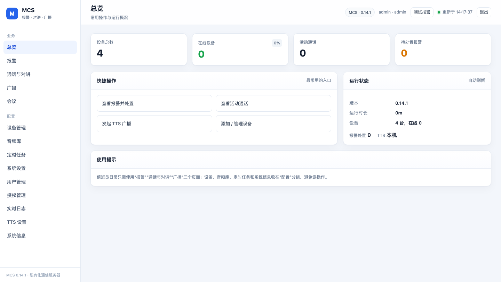

# MCS 文档索引

## 当前实现（以此为准）

| 文档 | 面向 |
| --- | --- |
| [MCS 架构说明](MCS-架构说明.md) | 部署拓扑、进程内分层、呼叫/媒体/广播/报警机制、数据与接口边界 |
| [MCS 使用手册](MCS-使用手册.md) | 部署、登录、设备、报警、广播、寻呼、对讲、TLS/SRTP、故障排查 |
| [MCS API 参考](MCS-API参考.md) | 当前 REST / WebSocket 字段、错误码、curl 示例 |
| [OpenAPI 规范](openapi.yaml) | 机器可读的 OpenAPI 3.0.3（导入 Apifox/Postman） |
| [测试与兼容性](MCS-测试与兼容性.md) | 自动化测试覆盖、已验证环境、兼容边界 |
| [真机测试指南](MCS-真机测试指南.md) | LAN 拓扑、终端配置、测试用例、抓包排查 |
| [广播终端接入](MCS-广播终端接入.md) | Alert-Info、SDP、PCMU、单播/组播实现要求 |
| [TTS 服务配置](MCS-TTS服务配置.md) | 本地/OpenAI/千问/MiniMax，配置页与 API |
| [实时日志](MCS-实时日志.md) | WebSocket 日志控制台、486 呼叫排查 |
| [MCS 配置参考](MCS-配置参考.md) | `config.yaml` 字段/默认值/数据目录 |
| [部署手册](../deploy/README.md) | systemd、Windows、Linux 包、SIP TLS、HTTPS、SRTP |

## 规划/设计（含未实现内容）

| 文档 | 说明 |
| --- | --- |
| [MCS 产品方案](MCS-产品方案.md) | 产品定位、范围、版本路线图 |
| [MCS 技术方案](MCS-技术方案.md) | 早期设计与规划；当前实现架构以架构说明为准 |
| [MCS 接口与数据模型](MCS-接口与数据模型.md) | 远期 API/数据模型；当前实现见 API 参考 |
| [可行性评估与总体方案](可行性评估与总体方案.md) | 早期选型与可行性分析 |

## 建议阅读顺序

1. 想先跑起来：[使用手册 §2](../docs/MCS-使用手册.md#2-快速开始) 或 [部署手册](../deploy/README.md)；
2. 接前端/第三方：[API 参考](MCS-API参考.md)；
3. 改配置：[配置参考](MCS-配置参考.md)；
4. 看实现架构：[架构说明](MCS-架构说明.md)；产品与规划：[产品方案](MCS-产品方案.md)、[技术方案](MCS-技术方案.md)。
